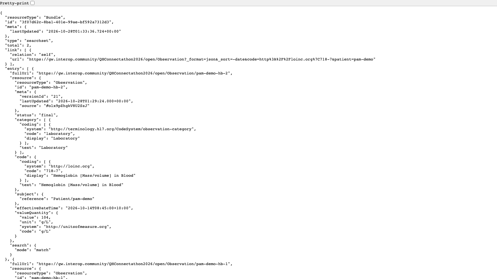

<!-- _class: title -->
<!-- _paginate: false -->
<!-- _header: "" -->

# SMART apps

## Launch from the EHR, read the patient's record

Track 1: FHIR for Users. FHIR in Queensland Health Connectathon, 29–30 Oct 2026
Jim Steel, Leonie Dickson (AEHRC), Leon Cavalli (QH)

**Slides: aehrc.github.io/qh-connectathon/decks**

<!--
About 15 minutes. After this, the apps people can go and start; forms people stay.
Before: logged in to Meld, sandbox QHConnectathon2026, in its own tab. The latest-Hb URL open in another tab.
-->

---

## What you'll have by the end of this deck

- How an **EHR launch** works: launch → authorize → token (with the patient) → FHIR calls
- Your app **hosted where Meld can launch it** (CodeSandbox, GitHub Pages or any public HTTPS host), with a **client ID** from Jim
- Two starting points, fixed for Meld: the **patient-app starter** (React, from CodeSandbox) and **`apps/pam-dashboard`** (plain HTML/JS, for population apps)
- A first app: **the current patient's Hb results**, the start of scenario **B1**

Forms people: **Smart Forms is itself a SMART app.** The launch context and token in this deck are what prepopulation runs on.

Sandbox: Meld `QHConnectathon2026`. Secured endpoint (apps): `https://gw.interop.community/QHConnectathon2026/data`. Open endpoint (no login, for testing): `https://gw.interop.community/QHConnectathon2026/open`.

<!--
Four things you'll leave with. The hosting one is new: your app has to live somewhere Meld can reach it.
Two starting points: the React starter for one patient, our dashboard for the population.
Forms people: stay for this one. Smart Forms is a SMART app, and prepopulation runs on exactly this launch and token.
-->

---

## The EHR launch, in four steps

<div class="flow">

<div>

### 1. Launch
The EHR (Meld) opens your **launch URI** with `?iss=<FHIR server>&launch=<opaque id>`.

</div>

<div>

### 2. Authorize
Your app sends the browser to the server's **authorize** endpoint: client ID, scopes, redirect URI, `launch`.

</div>

<div>

### 3. Token
The server sends the browser back to your **redirect URI** with `?code=...`. The app swaps the code for an **access token** plus the context: **`patient`**.

</div>

<div>

### 4. FHIR calls
Every request carries `Authorization: Bearer <token>`. Reads are limited by the **scopes** granted.

</div>

</div>

**fhirclient.js does all four.** `FHIR.oauth2.init()` = step 2 on the first visit, step 3 when it comes back. Then `client.patient.id` is the launch patient and `client.request(...)` adds the token.

Endpoints come from `https://gw.interop.community/QHConnectathon2026/data/.well-known/smart-configuration`.

<!--
This is the whole of SMART on FHIR's EHR launch. Four steps, all in the browser.
The key idea: the EHR tells your app which patient, via the launch parameter, and the token comes back with that patient.
You won't write any of this: fhirclient's init does steps 2 and 3, then you just make requests.
-->

---

<style scoped>pre, pre code { font-size: 16px; }</style>

## What comes back in step 3

The token response (shape, values shortened):

```json
{
  "access_token": "eyJhbGciOi...",
  "token_type": "Bearer",
  "expires_in": 3600,
  "scope": "launch openid fhirUser patient/*.read patient/*.write",
  "patient": "pam-001",
  "id_token": "eyJ0eXAiOi..."
}
```

| In fhirclient | Comes from |
|---|---|
| `client.patient.id` | `patient` in the token response: the patient selected at launch |
| `client.patient.read()` | `GET Patient/<that id>` |
| `client.request("Observation?...")` | `GET <iss>/Observation?...` with the Bearer token |
| `client.user.fhirUser` | the `id_token` (needs `openid fhirUser`) |

<!--
What fhirclient actually gets back. The patient field is the important one: that's the patient selected in Meld.
The scope field shows what you were granted, which can be less than you asked for.
The table maps it to the fhirclient calls you'll use in a moment.
-->

---

## Meld: our EHR for the two days

Meld (`https://meld.interop.community`, sandbox **QHConnectathon2026**) plays the EHR:

- **FHIR server**: the 40 synthetic PAM patients (`pam-001`..`pam-040`) and the demo patient `pam-demo`
- **Launcher**: picks a patient and opens your app's launch URI with `iss` and `launch`
- **Authorization server**: knows each registered app (client ID, launch URI, redirect URIs, scopes)

You **don't register apps yourself**: Jim registers yours and gives you a client ID (next slide).

**Launch with a patient selected.** Without one, Meld's launcher stops on a blank page.

<!--
Meld is our pretend EHR: a FHIR server, a launcher and an authorization server.
You don't register apps yourselves: I do. Next few slides cover how to get one.
The one gotcha everyone hits: launch with a patient selected, or you get a blank page.
-->

---

## Where your app lives

Meld launches your app by opening its **launch URI** in the browser, so the app needs a **public HTTPS address**. Chrome blocks a launch from Meld to `http://localhost`.

<div class="cards">
<div>

**CodeSandbox** (easiest for the starter)
Edit in the browser; your fork is hosted for you at its preview URL. Sign in with GitHub or Google.

</div>
<div>

**GitHub Pages**
Any public repo; every commit is published at `https://<you>.github.io/<repo>/`. Optional: our template repo with a ready-made app.

</div>
<div>

**Something else?** Fine too: Netlify, Vercel, Azure Static Web Apps, your own server… Anything that serves your files over public HTTPS works.

</div>
</div>

Wherever it lives, you then send Jim its URLs for a client ID (*Get a client ID from Jim*). Step-by-step for the first two next.

<!--
Your app needs a public HTTPS address, because Chrome blocks a jump from Meld to localhost.
CodeSandbox is easiest for the React starter; GitHub Pages is easiest for plain HTML like our dashboard.
Anything else that serves files over HTTPS is fine too: use what you already know.
The next two slides are step-by-step for reading later: I'll skim them.
-->

---

<style scoped>p, li { font-size: 0.8em; }</style>
<!-- _class: reference -->

## Hosting on CodeSandbox

1. Open the starter: `https://codesandbox.io/p/sandbox/smart-on-fhir-0rd1q` and **sign in** (GitHub or Google account).
2. **Fork** it (top right). Your copy has its own editor URL; bookmark it.
3. In the preview pane, **open the preview in a new tab**. That tab's address (e.g. `https://abc123.csb.app/`) is your app's URL: copy it exactly, **with the trailing `/`**.
4. Send Jim your URLs (*Get a client ID from Jim*; for the starter, that URL is both launch and redirect URI), and put the client ID he sends back in `src/index.js`.
5. Edits save as you type and the hosted URL serves the latest version: no deploy step.
6. **Launch from Meld**, not from the preview pane: the app needs Meld's `iss` and `launch` parameters. To try queries without a launch, use the no-login URL on the *Run it* slide.

<!--
Skim: this is here for reading back.
The two things to stress: copy the preview URL with its trailing slash, and launch from Meld, not from the preview pane.
Honest caveat: we couldn't automate CodeSandbox, so if the URL looks different from the example, send me what you see.
-->

---

<style scoped>p, li { font-size: 0.75em; } li li { font-size: 1em; } pre, pre code { font-size: 15px; }</style>
<!-- _class: reference -->

## Hosting on GitHub Pages

1. **A public repo with your app**, `index.html` at the top (Pages on a free account needs a public repo). Either:
   - your own: **New repository**, then **Add file → Upload files** (or push with git); or
   - **our template** `https://github.com/aehrc/qh-connectathon-smart-starter` → **Use this template**: a plain HTML patient app (B1) and the dashboard in `population/` (B2–B8), no build step, client IDs in `config.js`.
2. **Settings → Pages → Build and deployment**: Source **Deploy from a branch**, branch **`main`**, folder **`/ (root)`**, **Save**.
3. After a minute or so the Pages settings show your URL: `https://<you>.github.io/<repo>/`. Send Jim the URLs (*Get a client ID from Jim*).
4. Edit in the browser (pencil icon) or push with git; every commit republishes in about a minute (progress under **Actions**).

**The React starter** needs a build first: add `"homepage": "."` to `package.json`, `npm run build` (on Node 17+ prefix `NODE_OPTIONS=--openssl-legacy-provider`), and upload the **contents** of `build/`.

<!--
Skim: also for reading back.
Any public repo works: turn on Pages from main, and a minute later you have a URL.
If you want a head start, our template repo has a plain HTML patient app and the dashboard, no build step, with its own README.
The React starter needs a build before it can go on Pages.
-->

---

<style scoped>p, li { font-size: 0.85em; } pre, pre code { font-size: 16px; }</style>

## Get a client ID from Jim

1. Get your app's public URL (CodeSandbox, GitHub Pages or your own host).
2. Send Jim:

```
Team / app name:  B1 Hb viewer (your names)
Launch URI:       https://abc123.csb.app/
Redirect URI:     https://abc123.csb.app/
Scopes:           launch openid fhirUser patient/*.read patient/*.write
```

3. Put the client ID he sends back where your app sets `clientId` (the React starter: **`src/index.js`**; our Pages template: `config.js`).

**Launch URI**: the page Meld opens, which starts the login (fhirclient `authorize()` or `init()`). **Redirect URI**: the page the login comes back to (`ready()` or `init()`). Our starters do both on one page with `init()`, so it's **one URL for both** (as above); an app with a `launch.html` and an `index.html`, like the dashboard, has **two**. Copy them exactly, **with the trailing `/`**. Moved host? Send Jim the new URLs.

<!--
This is what you send me. Launch URI, redirect URI, scopes, and a name I can recognise.
Launch URI is the page that starts the login; redirect URI is where it comes back. Our starters do both on one page, so one URL; the dashboard has two pages, so two URLs.
Copy the URL exactly, trailing slash included: one character off and the launch fails.
If you move hosts, send me the new URL and I'll update the registration.
-->

---

## Scopes on Meld: SMART v1 only

| Scope | Gives |
|---|---|
| `launch` | EHR launch: the patient (and context) from the launcher |
| `openid fhirUser` | who the user is (`client.user`) |
| `patient/*.read` | read anything **about the launch patient** |
| `patient/*.write` | create and update for that patient (the starter's "Update" form) |
| `user/*.read` | read **everything** the user can see: population views (B2–B8) |

Also supported: `patient/*.*`, `launch/patient`, `profile`, `online_access`, `offline_access`.
**Not** supported: v2 scopes (`patient/*.rs`, `.cruds`), `launch/questionnaire`, resource-specific user scopes such as `user/Practitioner.read`.

**The scopes you request must be a subset of the scopes registered** for your client ID, or the launch fails with `invalid_scope`. So send Jim every scope you'll want.

<!--
Meld only does SMART v1 scopes, so star-dot-read, not the v2 dot-rs style.
The rule that bites: you can only request scopes that were registered. So ask me for everything you'll need up front.
Patient scopes for a one-patient app; user star read for population views.
-->

---

<style scoped>p { font-size: 0.88em; }</style>

## The React starter (CodeSandbox): what's in it

**Using our Pages template, or your own app?** The fixes and the Hb table are already in the template (*Same app, no build*); the ideas apply to any fhirclient app.

`https://codesandbox.io/p/sandbox/smart-on-fhir-0rd1q`: Create React App (React 17, `react-scripts` 4).

| File | Does |
|---|---|
| `src/index.js` | `FHIR.oauth2.init({ clientId, scope })`, then renders `<App client={client} />` |
| `src/App.jsx` | reads the launch patient, shows it with `PatientVisualizer`, a form to update the name |
| `package.json` | `fhirclient` (^2.4, today 2.6.3), `fhir-visualizers` 0.0.6, `react-bootstrap`, `react-hook-form` |

Three things to change for Meld: **1.** `clientId` belongs to another registration: use yours from Jim. **2.** `scope` `launch/patient openid profile` asks for **no data**. **3.** In `App.jsx`, `useEffect` runs on every render (a request loop) and the update mutates React state.

<!--
The starter came with the programme. It works, but not on Meld as it is.
Three fixes: your client ID, scopes that actually ask for data, and a React effect that loops.
Next two slides show each fix.
-->

---

<style scoped>pre, pre code { font-size: 16px; }</style>

## React starter, fix 1 and 2: `src/index.js`

```js
const smartLaunch = () => {
  // Authorize application
  FHIR.oauth2
    .init({
      clientId: '<client id from Jim>',                              // was another app's id
      scope: 'launch openid fhirUser patient/*.read patient/*.write' // was 'launch/patient openid profile'
    })
    .then(client => {
      ReactDOM.render(<App client={client} />, rootElement);
    })
    .catch(err => { rootElement.textContent = String(err); });      // added: show errors
};

smartLaunch();
```

<div class="small">

- **`launch`**, not `launch/patient`: Meld starts an **EHR** launch; `launch/patient` asks for a patient picker in a standalone launch. (fhirclient adds `launch` itself only if the scope has no "launch" in it.)
- **`patient/*.read`** to read the record; **`patient/*.write`** only because the starter's form updates the Patient.

</div>

<!--
Fix one: your client ID from me. Fix two: the scope. The original asks for no data at all, so every read would fail.
launch, not launch slash patient: Meld does an EHR launch, where the patient comes from the launcher.
I also added a catch so errors show on the page instead of a blank screen.
-->

---

<style scoped>pre, pre code { font-size: 16px; }</style>

## React starter, fix 3: `src/App.jsx`

```jsx
  useEffect(() => {
    client.patient.read().then((patient) => setPatient(patient));
  }, [client]);   // added: without it the effect runs after every render -> read -> setPatient
                  // -> render -> read ... (a request loop)
```

```jsx
  const onSubmit = data => {
    const np = JSON.parse(JSON.stringify(patient));  // was: let np = patient (changes the state object)
    np.name[0].given[0] = data.fname;
    np.name[0].family = data.lname;
    client.update(np).then(setPatient);   // the server's copy: a new object, so React re-renders
  };
```

`setPatient` with the same object it already holds doesn't re-render, so the old code changed the name in memory but not on screen.

**Please don't rename the shared patients** (`pam-001`..`pam-040`, `pam-demo`): other people use them. Remove the form, or try it on a Patient you created.

<!--
Fix three: without the dependency array, the effect re-runs every render, which reads the patient, which re-renders. A request loop.
The update copied the state object by reference, so React didn't notice the change.
Please don't rename the shared patients: other people are using them.
-->

---

<!-- _class: demo -->
<style scoped>pre, pre code { font-size: 13px; } .split > div:first-child img { width: auto; max-height: 280px; } .split { grid-template-columns: auto minmax(0, 1fr); }</style>

## First app: try the query in your browser

The patient's Hb results, newest first. Paste into Edge or Chrome (or [open it](https://gw.interop.community/QHConnectathon2026/open/Observation?code=http://loinc.org%7C718-7&patient=pam-demo&_sort=-date&_format=json)):

```
https://gw.interop.community/QHConnectathon2026/open/Observation?code=http://loinc.org%7C718-7&patient=pam-demo&_sort=-date&_format=json
```

<div class="split">

<div>



</div>

<div>

- LOINC **718-7**: Haemoglobin, `system|code` with `|` as **`%7C`**
- No `_count=1` (the form's query has it): we want **all** results; `&_format=json` only for the browser
- `"total": 2`: `pam-demo-hb-2` **104 g/L** (14 Oct 2026), `pam-demo-hb-1` **112 g/L** (2 Sep 2026)
- `pam-demo` is shared: if someone has done the write-back demo you'll see their result (e.g. 98 g/L, 27 Oct) as the latest, and more than 2 results

</div>

</div>

<!--
DEMO (guide section 2). Switch to the latest-Hb tab, or paste the URL from the slide.
Expect a Bundle, total 2: pam-demo-hb-2 104 g/L on 14 Oct, then pam-demo-hb-1 112 g/L on 2 Sep.
Point out the %7C for the bar between system and code, and _format=json for the browser.
If write-back demos have run without a reset, there's a third, newer Hb (e.g. 98). Fallback: the screenshot on the slide.
-->

---

<style scoped>pre, pre code { font-size: 16px; } li { font-size: 0.9em; }</style>

## First app, React starter: `src/HbResults.jsx` (new file)

```jsx
import React, { useEffect, useState } from 'react';
import { ObservationsVisualizer } from 'fhir-visualizers';
import { Spinner } from 'react-bootstrap';

export default function HbResults({ client }) {
  const [hb, setHb] = useState(null);
  const [error, setError] = useState(null);
  useEffect(() => {
    client
      .request(`Observation?code=http://loinc.org%7C718-7&patient=${client.patient.id}&_sort=-date`,
        { flat: true })
      .then(setHb)
      .catch(setError);
  }, [client]);
  if (error) return <p className="text-danger">{String(error)}</p>;
  if (!hb) return <Spinner animation="border" />;
  return <ObservationsVisualizer title="Haemoglobin" rows={hb} />;
}
```

- `client.patient.id`: the launch patient. `client.request` adds the token.
- `{ flat: true }`: an array of Observations, not the Bundle (first page; `pageLimit: 0` for all).

<!--
Our first app: the same query, through fhirclient, for the launch patient.
client.patient.id is the patient from Meld; client.request adds the token for you.
flat true gives you an array of Observations instead of a Bundle.
-->

---

<style scoped>pre, pre code { font-size: 15px; }</style>

## React starter: wire it in, and what you'll see

<div class="two">

<div>

In `src/App.jsx`:

```jsx
import HbResults from './HbResults';
...
      <Container>
        {pat}
      </Container>
      <Container>
        <HbResults client={client} />
      </Container>
```

For `pam-demo`, `client.request` returns (checked with fhirclient 2.6.3):

```
pam-demo-hb-2  2026-10-14T08:45:00+10:00  104 g/L
pam-demo-hb-1  2026-09-02T09:15:00+10:00  112 g/L
```

</div>

<div>

`ObservationsVisualizer` (fhir-visualizers 0.0.6) shows a table: code, value, effective, issued, id. It **reverses** the rows, so newest-first in gives oldest-first on screen.

Your own table instead, newest first:

```jsx
<table className="table table-sm">
  <tbody>
    {hb.map((o) => (
      <tr key={o.id}>
        <td>{o.effectiveDateTime?.substring(0, 10)}</td>
        <td>{o.valueQuantity?.value} {o.valueQuantity?.unit}</td>
      </tr>
    ))}
  </tbody>
</table>
```

</div>

</div>

<!--
Two lines to wire it in. That's B1 started: the rest is making it nicer.
Watch out: the visualizer reverses the rows, so it shows oldest first. The table on the right keeps newest first.
-->

---

<style scoped>pre, pre code { font-size: 15px; } p, li { font-size: 0.85em; }</style>

## Same app, no build: the Pages template

`https://github.com/aehrc/qh-connectathon-smart-starter` does the same as the fixed React starter plus `HbResults`, in plain JavaScript (`app.js`):

```js
FHIR.oauth2.init({ clientId: cfg.clientId, scope: cfg.scope })   // from config.js
  .then(client => Promise.all([showPatient(client), showHb(client)]));

async function showHb(client) {
  const hb = await client.request(
    'Observation?code=' + encodeURIComponent('http://loinc.org|718-7') +
    '&patient=' + client.patient.id + '&_sort=-date', { flat: true });
  // ...one table row per Observation: date, value and unit, id
}
```

- Same launch (`init()` on one page), same query, same result: `pam-demo` shows 104 g/L (14 Oct) then 112 g/L (2 Sep).
- Opened without a launch, it tells you how to launch it instead of failing.
- `population/` is the dashboard, ready for its own client ID (`populationClientId` in `config.js`).

<!--
For anyone on GitHub Pages: our template is the same app without React or a build step.
Same init call, same query, same table; the client ID and scopes live in config.js.
Your own app on any host works the same way: it's fhirclient either way.
-->

---

<style scoped>pre, pre code { font-size: 15px; } p { font-size: 0.85em; }</style>

## Run it

**From Meld (the real thing):** launch your app from the sandbox with a patient selected. It opens your launch URI with `?iss=https://gw.interop.community/QHConnectathon2026/data&launch=...`, goes to Meld's login and authorize page, then comes back with `?code=...&state=...` and shows the patient and their Hb.

**Without Meld (while you code):** fhirclient's `fhirServiceUrl` and `patientId` URL parameters skip OAuth and use the open endpoint:

```
https://<your app's URL>/?fhirServiceUrl=https://gw.interop.community/QHConnectathon2026/open&patientId=pam-demo
```

(Your preview URL on CodeSandbox, your `github.io` URL on Pages, or wherever it's hosted. No client ID or token needed; don't ship it.)

**Opened it with neither?** The React starter's `init()` fails with *No server url found* (there's no `iss`); the template says how to launch it.

<!--
Two ways to run it. For real: launch from Meld with a patient selected.
While coding: the fhirServiceUrl and patientId parameters skip login and use the open endpoint. Handy, but don't ship it.
Optional live demo (guide section 5): launch from Meld with a patient selected. Fallback: open the dashboard URL with ?server= set to the open endpoint.
-->

---

## Gotchas on Meld

<div class="cards" style="grid-template-columns: 1fr 1fr 1fr;">

<div>

### `|` → `%7C`
A raw `|` in a query gets **HTTP 400** with no CORS headers: the browser says **CORS error**. fhirclient doesn't encode it. Write `%7C`, or `encodeURIComponent('http://loinc.org|718-7')` (needed through launch.smarthealthit.org).

</div>

<div>

### Pick a patient
Launch without a patient selected and Meld stops on a **blank page**.

</div>

<div>

### Scopes ⊆ registered
Request only scopes registered for your client ID, v1 only, or you get `invalid_scope`.

</div>

<div>

### Redirect URIs
Must match **exactly**, trailing `/` included. Several go **comma-separated** in the registration.

</div>

<div>

### `_format=json`
In the browser's address bar, or Meld sends XML and the browser downloads a file.

</div>

<div>

### Relaunch in a new tab
`init()` revives the session in `sessionStorage` **before** it looks at a new `iss`/`launch`: in the same tab you get the **old** session, or *Patient is not available*. Our Pages template handles it.

</div>

</div>

<!--
The six things that will cost you an hour if you don't know them.
The worst is the pipe character: Meld returns a 400 with no CORS headers, so the browser reports a CORS error that's nothing to do with CORS.
And relaunch in a new tab: fhirclient revives the old session in the same tab.
-->

---

<style scoped>table { font-size: 0.7em; } p { font-size: 0.9em; }</style>

## No build step: `apps/pam-dashboard`

A fuller example in the repo: plain HTML + fhirclient.js (from a CDN) + Plotly. **PAM 15/16 outcomes**: initial vs post-treatment Hb and ferritin by sex, from one FHIR search.

| | Starter (this deck) | Dashboard |
|---|---|---|
| View | one patient (B1) | the population (B2–B8) |
| Scope | `launch openid fhirUser patient/*.read patient/*.write` | `launch openid fhirUser online_access user/*.read` |
| Pages | one: `init()` | two: `launch.html` calls `FHIR.oauth2.authorize()`, `index.html` calls `FHIR.oauth2.ready()` |
| Fetch | first page | `client.request(query, { pageLimit: 0, flat: true })`: all pages |

Try it: `https://aehrc.github.io/qh-connectathon/pam-dashboard/`. No login: add `?server=https://gw.interop.community/QHConnectathon2026/open`.

<!--
For population apps, start from our dashboard instead: plain HTML, no build step.
Two pages: launch.html authorizes, index.html picks up the token. It reads all pages of results.
Show it: open the dashboard URL with ?server= set to the open endpoint.
-->

---

<style scoped>p { font-size: 0.8em; } pre, pre code { font-size: 16px; }</style>

## Your own population app (B2–B8) on Meld

**How it launches today:** an **EHR launch from Meld with any patient selected**; the app ignores the patient and reads the population with `user/*.read`. A standalone launch doesn't work on Meld yet (see `apps/pam-dashboard/README.md`; how a dashboard should launch is part of B9).

Copy `apps/pam-dashboard/` (or use `population/` in our template repo, *Hosting on GitHub Pages*) and **host it on a public HTTPS address**. Then send Jim a **different** registration from the starter's:

```
Team / app name:  B6 outcomes (your names)
Launch URI:       https://<your host>/<folder>/launch.html
Redirect URI:     https://<your host>/<folder>/
Scopes:           launch openid fhirUser online_access user/*.read
```

Put the client ID in `config.js` (`populationClientId`) if you used the template, or in **`launch.html`** (`const CLIENT_ID = '...'`). Launch and redirect URI differ here because the app uses `authorize()` on `launch.html` and `ready()` on `index.html`.

<!--
How population apps launch on Meld today: from the launcher with any patient, then ignore the patient and read everyone with user scope.
A proper standalone launch for a dashboard is part of B9.
Note the registration is different: launch.html as launch URI, the folder as redirect URI.
-->

---

<!-- _class: tryit -->

## Strand B: SMART apps

<div class="small">

| Start with | Scenario | From |
|---|---|---|
| **B1** Patient summary ★ | Hb and ferritin trend with thresholds, pathway, days to surgery | this deck's starter + `HbResults` |
| **B3** KPI tiles ★, **B5** Referral profile ★ | counts and breakdowns over the population | `apps/pam-dashboard` |
| **B2** Worklist ★★, **B4** Referrals ★★, **B6** Outcomes ★★, **B7** Demographics ★★, **B8** Filters ★★ | EpisodeOfCare, Task, ServiceRequest, Patient searches | `apps/pam-dashboard` |
| **B9** Analytics ★★★ | ViewDefinitions, Bulk `$export`, Measure | ask a track lead |

</div>

<div class="small">

- Scenarios: `2026-10-29/1-FHIR-For-Users/Scenarios.md` (strand B) and the data mapping in `FHIR-Mapping-DRAFT.md`
- Starter: `https://codesandbox.io/p/sandbox/smart-on-fhir-0rd1q`. Host on CodeSandbox, GitHub Pages (optional template: `https://github.com/aehrc/qh-connectathon-smart-starter`) or anywhere public HTTPS. Client ID: **send Jim your launch and redirect URI**
- Dashboard: `https://aehrc.github.io/qh-connectathon/pam-dashboard/` (code in `apps/pam-dashboard/`)
- How SMART launch works, request by request: [SMART App Launch Postman collection](https://www.postman.com/planetary-crescent-937142/smart-app-launch-hl7-au-connectathon/collection/xbq559p/smart-app-launch-introduction)
- Forms people: **Questionnaires** deck next

</div>

<!--
That's it for apps. B1 if you want the starter; B3 or B5 if you want the population view with a one-star start.
The Postman collection walks through the launch request by request, if you want to see what fhirclient does under the hood.
Apps people: off you go, and come and see me for a client ID. Forms people: Questionnaires next.
-->
