<!-- _class: title -->
<!-- _paginate: false -->

# Questionnaires

## Build a form definition in NLM Form Builder (LHC Forms)

Track 1: FHIR for Users. FHIR in Queensland Health Connectathon, 29–30 Oct 2026
Jim Steel, Leonie Dickson (AEHRC), Leon Cavalli (QH)

<!--
This is where the forms story starts: we build the definition of a form before we fill it in or write anything back.
Prepopulation and write-back build on exactly this form, so it's worth following even if you know Questionnaires.
Apps people: you've already split off; this deck is for the forms cohort.
-->

---

<style scoped>table { font-size: 0.72em; }</style>

## What you'll build

A cut-down **Pathology results** form: the start of the forms story. Prepopulation fills it in, write-back turns its answers into Observations.

| linkId | Text | Type | Details |
|---|---|---|---|
| `pam-pathology` | Pathology | group | |
| `pam-hb` | Haemoglobin (Hb) | decimal | unit `g/L` (UCUM) |
| `pam-ferritin` | Ferritin | decimal | unit `ug/L` (UCUM) |
| `pam-hb-date` | Date of latest Hb | date | |
| `pam-ext` | Results from an external lab | group | **repeats** |
| `pam-ext-test` | Test | choice | LOINC `718-7` Haemoglobin (Hb), `2276-4` Ferritin |
| `pam-ext-value` | Result | decimal | |
| `pam-ext-date` | Collected | date | |

<div class="small">

Target file: `decks/examples/pathology-walkthrough-stage1.json`. The linkIds are the real `pam-pathology` module's, so what you learn here carries over to the A-strand modules.

</div>

<!--
One small form: a pathology group with Hb, ferritin and a date, plus a repeating group for results from an external lab.
It's deliberately tiny, but it touches the item types we'll need later: decimals with units, a date, a coded choice, a repeating group.
The linkIds are the real module's, so when you move on to the A strand nothing has to be renamed.
-->

---

<style scoped>.two { grid-template-columns: minmax(0, 1.3fr) minmax(0, 1fr); } .two pre, .two pre code { font-size: 13px; } .two p { font-size: 0.7em; }</style>

## Questionnaire vs QuestionnaireResponse

<div class="two">

<div>

### Questionnaire: the form
Questions, types, units, answer lists. Written once. `pam-hb` in `examples/pathology-walkthrough-stage1.json`:

```json
{
  "linkId": "pam-hb",
  "text": "Haemoglobin (Hb)",
  "type": "decimal",
  "extension": [
    {
      "url": "http://hl7.org/fhir/StructureDefinition/questionnaire-unit",
      "valueCoding": {
        "system": "http://unitsofmeasure.org",
        "code": "g/L",
        "display": "g/L"
      }
    }
  ]
}
```

</div>

<div>

### QuestionnaireResponse: the answers
One per patient per filling-in. Same tree, matched by **`linkId`**. `pam-hb` in `examples/sample-qr.json`:

```json
{
  "linkId": "pam-hb",
  "text": "Haemoglobin (Hb)",
  "answer": [
    {
      "valueDecimal": 104
    }
  ]
}
```

Its `questionnaire` names the form by canonical `url|version`: `.../pathology-walkthrough|0.1.0`, the **finished** form built over the next decks (stage 1 has its own URL, `...-stage1`).

</div>

</div>

<!--
Two resources, easy to mix up: the Questionnaire is the blank form, written once; the QuestionnaireResponse is one filled-in copy.
They line up item by item through the linkId. That's the single most important idea for everything after this.
The response points back at the form by canonical URL and version, which is why identity matters (two slides on).
-->

---

<style scoped>table { font-size: 0.66em; } td, th { padding: 3px 10px; }</style>

## Anatomy of an item

| Element | What it does | In our form |
|---|---|---|
| `linkId` | The item's id, unique in the form. Answers, `enableWhen` and expressions use it | `pam-hb`, `pam-ext`, ... |
| `text` | The label the user sees | `Haemoglobin (Hb)` |
| `type` | What kind of answer (next slide) | `decimal`, `group`, `choice`, `date` |
| `required` | Must be answered: `"required": true` (builder: *Answer required* **Yes**) | none in stage 1 |
| `repeats` | Can be answered more than once; on a group, the whole group repeats | `pam-ext` |
| `item` | Child items (groups and nested questions) | under `pam-pathology` and `pam-ext` |
| `answerOption` | The allowed answers for a `choice` | LOINC codings on `pam-ext-test` |
| `extension` | Everything else: units, hidden, prepopulation, extraction | `questionnaire-unit` |
| `enableWhen` | Show the item only when another answer matches; a disabled item is usually hidden and its answers are left out of the response | bonus slide |

<div class="small">

Pick **linkIds that mean something** (`pam-hb`, not `1.1`): prepopulation, calculations and write-back all find items by linkId.

</div>

<!--
Every item is the same small set of fields. You'll set most of these in the builder in a minute.
Extensions are where the interesting SDC behaviour lives: units today, prepopulation and extraction in the next two decks.
Pick meaningful linkIds; every expression we write later finds items by linkId.
-->

---

<style scoped>table { font-size: 0.7em; } td, th { padding: 3px 10px; }</style>

## Item types

| Type | Answer | Example |
|---|---|---|
| `group` | none: holds other items | Pathology, Results from an external lab |
| `display` | none: text only | instructions, the 🚧 "to be built" boxes in the modules |
| `string` / `text` | short / long free text | name, notes |
| `integer` / `decimal` | number | **Hb, ferritin, result** |
| `quantity` | number + unit chosen by the user | weight in kg or lb |
| `date` / `dateTime` / `time` | date and/or time | **date of latest Hb, collected** |
| `boolean` | yes / no | consent given |
| `choice` / `open-choice` | a `Coding` from a list (`open-choice` also takes free text) | **Test: Hb or ferritin** |
| `reference` / `attachment` / `url` | a FHIR reference, a file, a link | |

<div class="small">

`choice` and `open-choice` are the **R4** names; R5 has `coding`, and NLM Form Builder shows that name. Every type rendered live: [Smart Forms Storybook, *ItemType*](https://smartforms.csiro.au/storybook/?path=/docs/itemtype-overview--docs).

</div>

<!--
Run through quickly; this is a reference table. The bold rows are the ones in our form.
Watch the naming: R4 says choice, R5 and NLM Form Builder say coding. Smart Forms and Meld are R4.
The Storybook link renders every type if you want to see them live.
-->

---

<style scoped>pre, pre code { font-size: 15px; } li { font-size: 0.8em; }</style>

## Identity: canonical URL and version

The top of `pathology-walkthrough-stage1.json` (`description` and `publisher` left out):

```json
  "resourceType": "Questionnaire",
  "id": "pathology-walkthrough-stage1",
  "url": "https://aehrc.github.io/qh-connectathon/track1/Questionnaire/pathology-walkthrough-stage1",
  "version": "0.1.0",
  "name": "PathologyWalkthroughStage1",
  "title": "Pathology results (walkthrough, stage 1)",
  "status": "draft",
  "experimental": true,
  "date": "2026-10-28",
```

- **`url` + `version`** = the canonical reference, written `url|version`. Responses, modules (`subQuestionnaire`) and Smart Forms find forms by it. Keep the same URL on every server.
- **`id`** is only where it sits on one server: `.../open/Questionnaire/pathology-walkthrough-stage1`.
- `title` is for people, `name` for computers. Bump `version` when you change linkIds.

<!--
The canonical URL plus version is the form's real identity: responses, modules and Smart Forms all look forms up that way.
The id is just where it happens to live on one server, so the same form can have different ids on different servers.
If you change linkIds, bump the version: existing responses depend on the old ones.
-->

---

<!-- _class: section -->
<!-- _paginate: false -->

# ▶ Demo: build it in NLM Form Builder

`https://formbuilder.nlm.nih.gov/`: free, in the browser, no login. Exports FHIR R4 JSON.

About 10 minutes live. Every step is on the next slides, with what you should see.

<!--
Switch to the browser now: tab (a), NLM Form Builder, already past the terms dialog (accept LOINC once per profile beforehand, guide section 1 First use).
About ten minutes live. The next slides repeat every step, so people can catch up afterwards.
If it offers to start from where you left off, choose Start from scratch.
-->

---

<!-- _class: demo -->
<!-- footer: "NLM Form Builder: https://formbuilder.nlm.nih.gov/ (checked with version 12.10.0, 28 Oct 2026)" -->

## Step 0: open the builder, accept the terms

<div class="split">

<div>

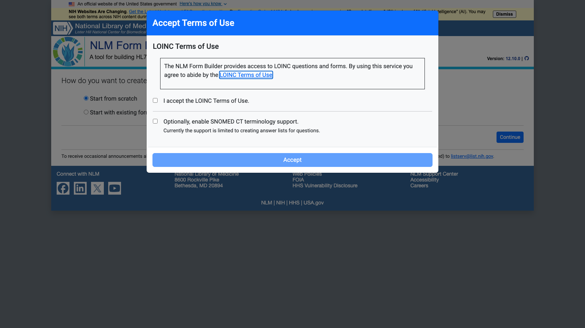

</div>

<div>

Open **https://formbuilder.nlm.nih.gov/** (it redirects to `lhncbc.nlm.nih.gov/formbuilder/`).

First time in a browser: *Accept Terms of Use*. Read them, tick **I accept the LOINC Terms of Use.**, then **Accept**. SNOMED CT support is optional (not needed here).

It's stored per browser profile: a private window asks again.

Optional: **Dismiss** the yellow NIH banner.

</div>

</div>

<!--
Free, browser-only, no login. It's NLM's builder, the same LHC Forms engine behind lots of US forms work.
The terms dialog appears once per browser profile; LOINC is enough for us, SNOMED is optional.
Cue: guide section 1, First use in a browser. Fallback screenshot: img/questionnaires/01-lhc-terms.png.
-->

---

<!-- _class: demo -->

## Step 1: new form, title

<div class="split">

<div>

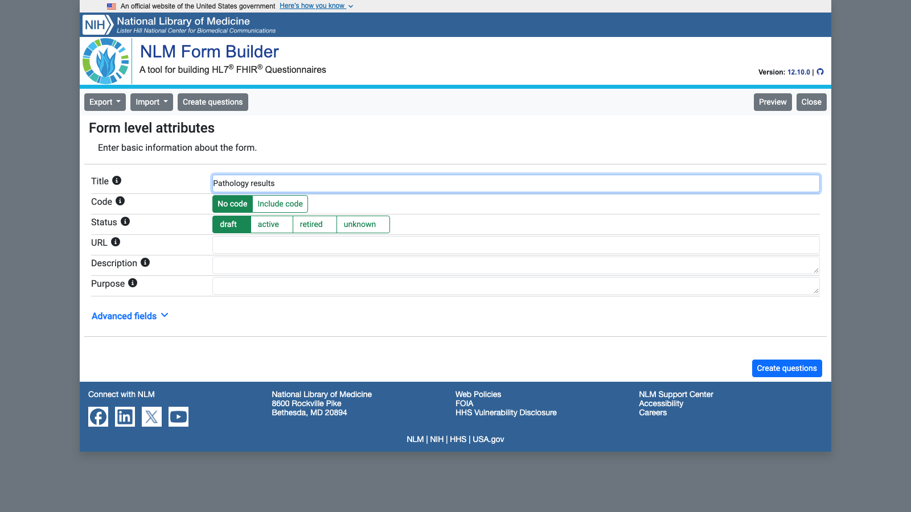

</div>

<div>

1. *How do you want to create your form?* **Start from scratch** → **Continue**. (Used the builder before? If it offers *start from where you left off*, pick **Start from scratch**.)
2. *Form level attributes*: **Title** `Pathology results`. Leave *Status* = **draft**.
3. **Create questions** (bottom right).

*URL* is the canonical `url`. We leave it empty, so the export has none.

</div>

</div>

<!--
Start from scratch, give it a title, leave status as draft.
We leave URL empty on purpose so you can see what the export looks like without identity; the next deck's files add it.
Cue: guide section 1, steps 1 and 2. Fallback screenshot: img/questionnaires/10-lhc-new-form.png.
-->

---

<!-- _class: demo -->

## Step 2: the group, then Haemoglobin

<div class="split">

<div>

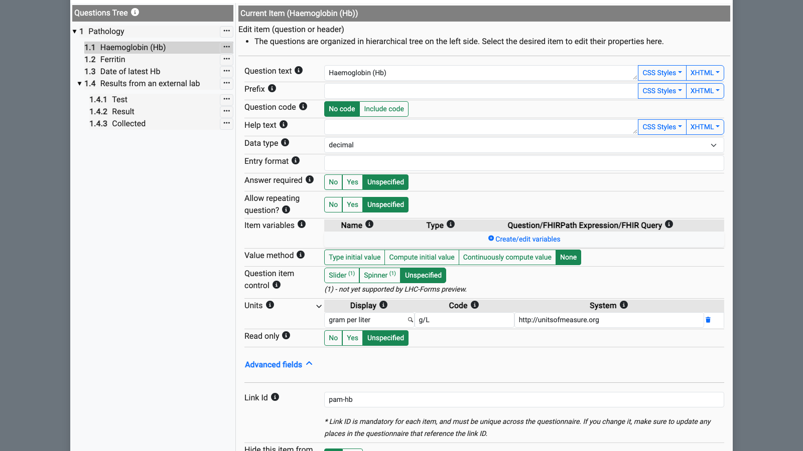

</div>

<div>

The builder adds *Item 0* and selects it:

- *Question text* `Pathology`, *Data type* `group`
- **Advanced fields ⌄** → *Link Id*: replace the number with `pam-pathology`

**…** on **1 Pathology** → **Insert a new child item**:

- *Question text* `Haemoglobin (Hb)`, *Data type* `decimal`
- *Units*: click **Display**, type `g/L`, press **Tab**. You get *gram per liter*, code `g/L`, system `http://unitsofmeasure.org`
- *Link Id* `pam-hb`

</div>

</div>

<!--
First the group, then Hb as a child of it. Open Advanced fields once; it stays open for the rest.
Type the unit and press Tab; don't pick from the drop-down (next slide says why).
Cue: guide section 1, steps 3 and 4. Fallback screenshot: img/questionnaires/11-lhc-item-editor.png.
-->

---

<!-- _class: demo -->

## Gotchas: Link Id and units

<div class="split">

<div>

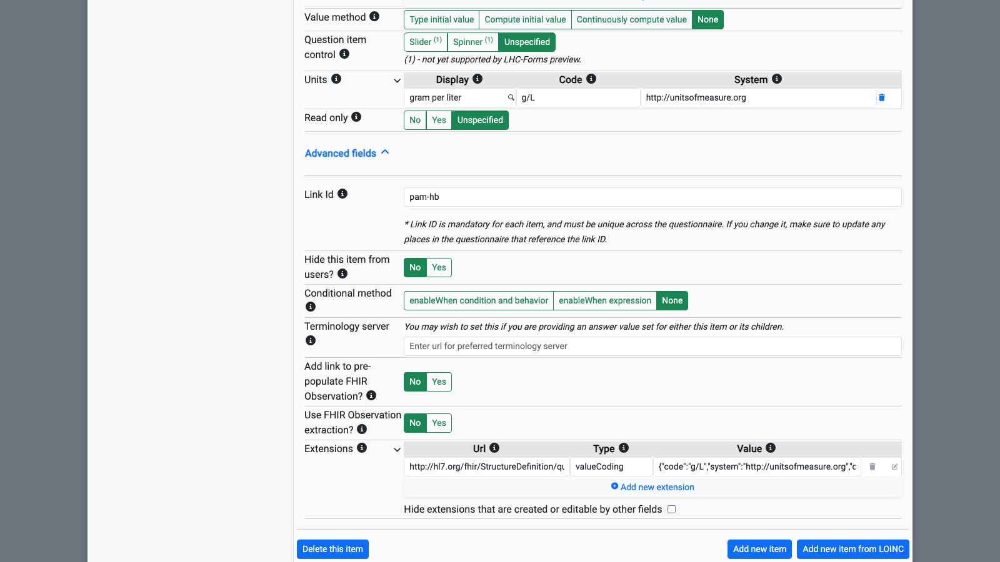

</div>

<div>

- **Link Id defaults to a random 12-digit number.** Type ours on **every** item, or the next decks' expressions won't find them.
- **Units: type, then Tab.** Picking from the drop-down while typing `g/L` gives its first match, *gram/Liters*, code `g/l`: valid UCUM, but not the `g/L` the module and the Observations use, so it won't match. To remove a unit, use the bin icon.
- The unit becomes the `questionnaire-unit` extension (the *Extensions* table at the bottom).

</div>

</div>

<!--
Two traps that will bite later. Random numeric Link Ids: type ours on every item or prepopulation and write-back won't find them.
The units drop-down's first match is lower-case g/l: valid UCUM, but it won't match the Observations.
Point at the Extensions table: the unit became a questionnaire-unit extension. Fallback screenshot: img/questionnaires/12-lhc-link-id.png.
-->

---

<!-- _class: demo -->

## Steps 3–4: Ferritin, date, the repeating group

<div class="split">

<div>

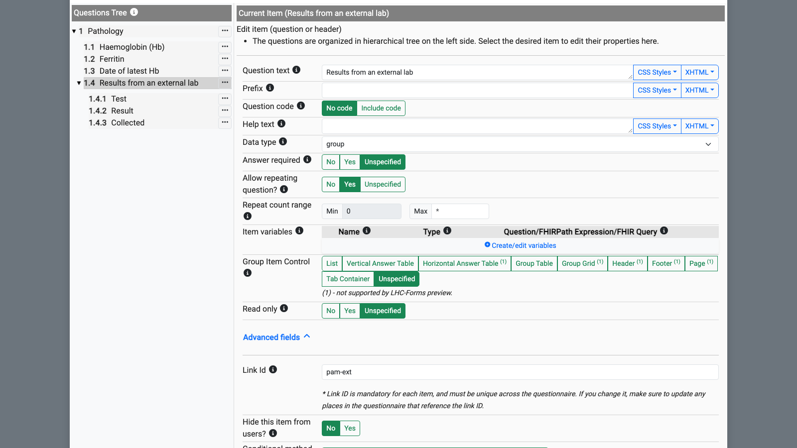

</div>

<div>

Each time: **…** on the item above → **Insert a new item after this**.

1. `Ferritin`, `decimal`, unit: type `ug/L` + **Tab** (→ *microgram per liter*), *Link Id* `pam-ferritin`
2. `Date of latest Hb`, `date`, *Link Id* `pam-hb-date`
3. `Results from an external lab`, `group`, *Allow repeating question?* **Yes**, *Link Id* `pam-ext`

**Yes** gives `"repeats": true`. A *Repeat count range* row appears (Min 0, Max \*): leave it.

</div>

</div>

<!--
Three siblings: ferritin, the date, then the external-lab group. Every time, the three-dot menu on the item above, Insert a new item after this.
Allow repeating question Yes is what makes the whole group repeat; leave the repeat count range alone.
Cue: guide section 1, steps 5 to 7. Fallback screenshot: img/questionnaires/14-lhc-repeating-group.png.
-->

---

<!-- _class: demo -->

## Step 5: Test, with LOINC answers

<div class="split">

<div>

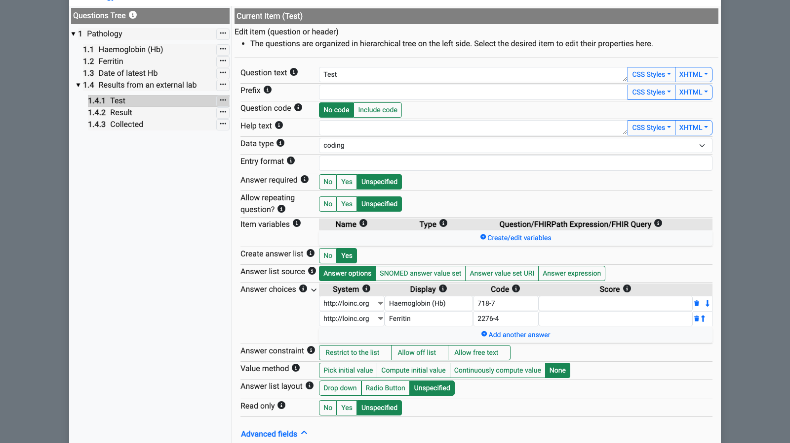

</div>

<div>

**…** on **1.4 Results from an external lab** → **Insert a new child item**:

- *Question text* `Test`, *Data type* **`coding`** (the builder's name for `choice`)
- *Create answer list* **Yes**; *Answer list source* **Answer options**
- *Answer choices*, row 1: *System* `http://loinc.org` (a combo box: just type), *Display* `Haemoglobin (Hb)`, *Code* `718-7`
- **Add another answer**, row 2: `http://loinc.org`, `Ferritin`, `2276-4`. Leave *Score* empty.
- *Link Id* `pam-ext-test`

</div>

</div>

<!--
Now a child inside the repeating group: Test, data type coding, which exports as choice in R4.
Two answer options with the LOINC system: 718-7 for Hb, 2276-4 for ferritin. The System box is a combo box; just type.
Cue: guide section 1, step 8. Fallback screenshot: img/questionnaires/13-lhc-answer-options.png.
-->

---

<!-- _class: demo -->

## Steps 6–7: Result, Collected, then Preview

<div class="split">

<div>

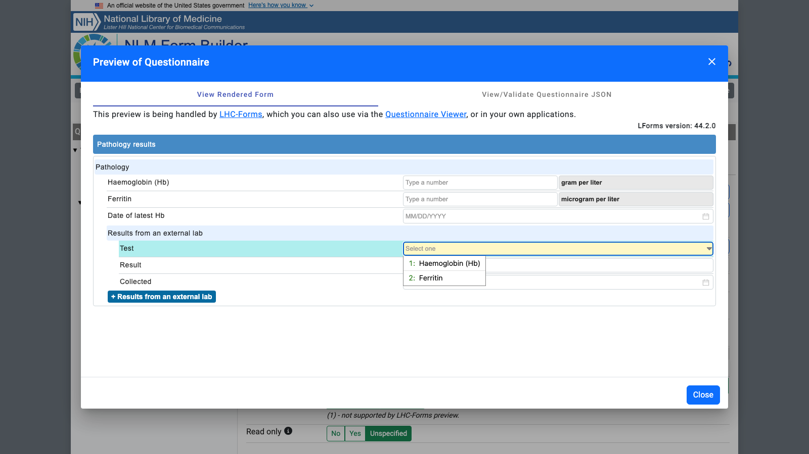

</div>

<div>

**…** on **1.4.1 Test** → **Insert a new item after this**: `Result`, `decimal`, *Link Id* `pam-ext-value`.

**…** on **1.4.2 Result** → **Insert a new item after this**: `Collected`, `date`, *Link Id* `pam-ext-date`.

**Preview** (top right) → *View Rendered Form*. You should see units *gram per liter* / *microgram per liter*; Test offers *1: Haemoglobin (Hb)*, *2: Ferritin*; **+ Results from an external lab** adds a repeat. Dates are US style (MM/DD/YYYY). **Close**.

</div>

</div>

<!--
Last two children, Result and Collected, then Preview to see it rendered.
Show the units, the Test drop-down, and the plus button that adds another external result. Dates are US style here.
Cue: guide section 1, steps 9 to 11. Fallback screenshot: img/questionnaires/15-lhc-preview.png.
-->

---

<!-- _class: demo -->

## Step 8: export R4

<div class="split">

<div>

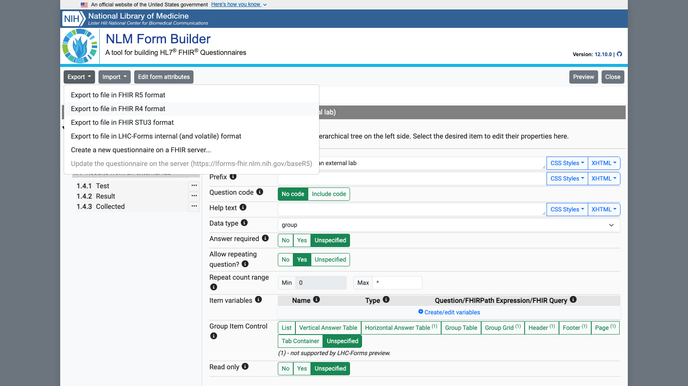

</div>

<div>

**Export ▾** (top left) → **Export to file in FHIR R4 format**.

It downloads **`Pathology-results.R4.json`** (named after the title).

Smart Forms and Meld are **R4**: don't pick R5.

*Create a new questionnaire on a FHIR server...* wasn't tried for this deck. To load to Meld, see *Optional: load your form to Meld*.

</div>

</div>

<!--
Export, FHIR R4 format. It downloads Pathology-results.R4.json, named after the title.
Don't pick R5; our tools are R4.
Cue: guide section 1, step 12. Expected content matches examples/lhc-export-stage1.json. Fallback screenshot: img/questionnaires/16-lhc-export-menu.png.
-->

---

<!-- footer: "" -->
<style scoped>.two pre, .two pre code { font-size: 12.5px; } .two { grid-template-columns: minmax(0, 0.9fr) minmax(0, 1fr); gap: 16px; }</style>

## What you get

The start of the real export, `examples/lhc-export-stage1.json`: the top, and the first question (indent shortened).

<div class="two">

<div>

```json
{
  "resourceType": "Questionnaire",
  "meta": {
    "profile": [
      "http://hl7.org/fhir/4.0/StructureDefinition/Questionnaire"
    ]
  },
  "title": "Pathology results",
  "status": "draft",
  "item": [
    {
      "linkId": "pam-pathology",
      "text": "Pathology",
      "type": "group",
      "item": [
```

</div>

<div>

```json
{
  "extension": [
    {
      "url": "http://hl7.org/fhir/StructureDefinition/questionnaire-unit",
      "valueCoding": {
        "system": "http://unitsofmeasure.org",
        "code": "g/L",
        "display": "gram per liter"
      }
    }
  ],
  "linkId": "pam-hb",
  "text": "Haemoglobin (Hb)",
  "type": "decimal"
},
```

</div>

</div>

No `id`, `url` or `version`: we only typed a title. The `item` tree is the same as the stage 1 file's, apart from the unit `display`.

<!--
This is the real export from those steps, trimmed. Point at meta.profile at the top, and no id, url or version, because we only typed a title.
The unit display is the UCUM name, gram per liter, not g/L.
Otherwise the item tree is the same as our stage 1 file.
-->

---

<style scoped>table { font-size: 0.62em; } td, th { padding: 3px 10px; } li { font-size: 0.75em; }</style>

## Builder export vs the stage 1 file

| | Builder export | `pathology-walkthrough-stage1.json` |
|---|---|---|
| `meta.profile` | `http://hl7.org/fhir/4.0/StructureDefinition/Questionnaire` | none |
| `id`, `url`, `version`, `name`, `date`, `publisher`, `description` | absent | present |
| `title` | `Pathology results` | `Pathology results (walkthrough, stage 1)` |
| unit `display` | `gram per liter`, `microgram per liter` | `g/L`, `µg/L` |
| unit `system` / `code`, linkIds, types, `answerOption`, `repeats` | same | same |

- **Data type `coding`** in the builder is **`choice`** in the R4 export.
- **Unit display** is the UCUM name. The Display box is a search box, so edit the JSON if you want `g/L`.
- **Don't click *Run Validation*** (Preview → *View/Validate Questionnaire JSON*): it fails on the builder's own `meta.profile` (*Failed to retrieve profile*). The form is fine: Meld's `Questionnaire/$validate` only warns (no narrative, no `name`).
- The builder keeps your form in the browser and offers it back next time.

<!--
The differences are all at the top of the file, not in the items: identity fields, the title and the unit display text.
Warn them: don't click Run Validation in the builder; it fails on the builder's own profile, not on your form. Meld only warns.
The builder remembers your form in the browser, handy for picking up later.
-->

---

## Short of time? Import the finished file

<div class="split">

<div>

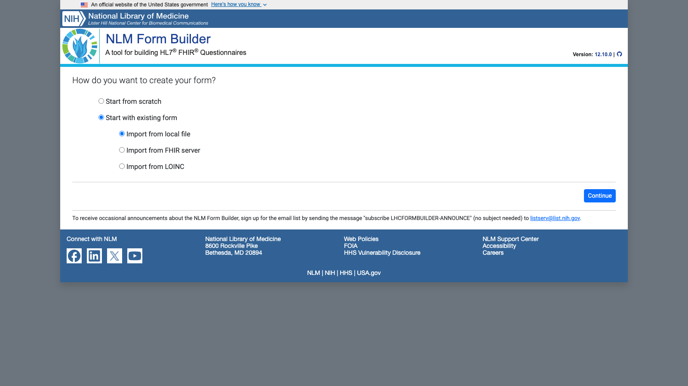

</div>

<div>

Download [`pathology-walkthrough-stage1.json`](https://github.com/aehrc/qh-connectathon/blob/main/2026-10-29/1-FHIR-For-Users/decks/examples/pathology-walkthrough-stage1.json) (**Raw** → save).

Start screen: **Start with existing form** → **Import from local file** → **Continue** → pick the file. It opens on *Form level attributes*, title *Pathology results (walkthrough, stage 1)*. **Edit questions** shows the tree.

Inside the builder: **Import ▾** → **Import from file...** → *Replace existing form?* → **Continue**.

Import then export R4 gives the same JSON, plus `meta.profile`.

</div>

</div>

<!--
If the live build runs long or the site has changed, import the finished file instead.
Start with existing form, Import from local file, then pick examples/pathology-walkthrough-stage1.json.
Cue: guide section 1, Fallback. Screenshot: img/questionnaires/17-lhc-import-existing.png.
-->

---

<!-- _class: demo -->

## Render it in Smart Forms

<div class="split">

<div>

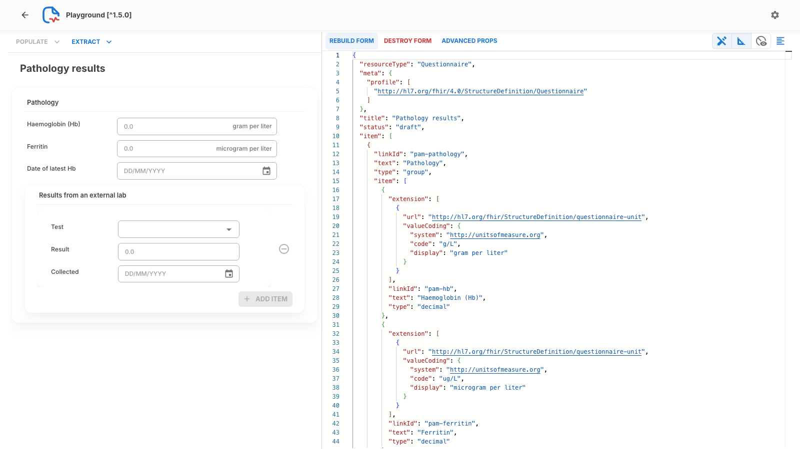

</div>

<div>

1. Open **https://aehrc.github.io/qh-connectathon/smart-forms/** → **GO TO PLAYGROUND** (left sidebar).
2. Paste your `Pathology-results.R4.json` into the JSON editor on the right, replacing what's there (or drop the file on the dashed box).
3. **BUILD FORM** (right panel header).

You should see *Pathology results*, units *gram per liter* / *microgram per liter*, and **ADD ITEM** for another external result. **DESTROY FORM** goes back.

</div>

</div>

<!--
Now show the same form in a different renderer: our Smart Forms playground. Same JSON, different look; that's the point of a standard.
Cue: tab (b), the patched playground on GitHub Pages; paste the export into the JSON editor, BUILD FORM (guide section 4, Alternative to step 4).
Fallback screenshot: img/questionnaires/03-playground-lhc-export.png.
-->

---

<!-- _class: demo -->

## Or pick it from the forms server

<div class="split">

<div>

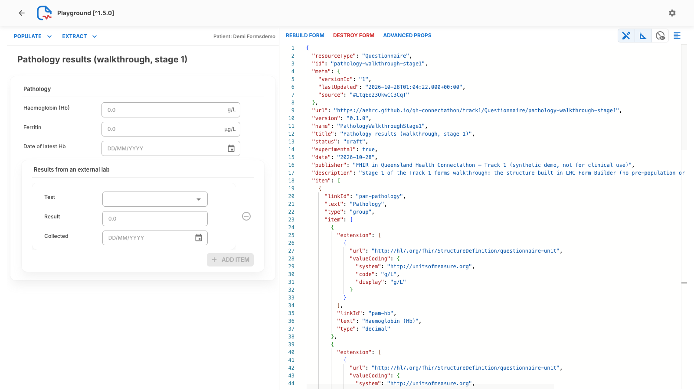

</div>

<div>

The stage 1 form is already on the Meld open endpoint, which is this playground's forms server.

*Or... pick a Questionnaire from our Forms Server*: type **`pathology-walkthrough-stage1`**, pick it → **BUILD FORM ▶**.

Units show as `g/L` and `µg/L` (this file's `display`); dates as DD/MM/YYYY.

Use this playground, not `smartforms.csiro.au/playground`: the public one can't read from Meld (it's fine for other servers). The next deck sets the patient (gear icon).

</div>

</div>

<!--
The stage 1 form is already on the Meld open endpoint, which is this playground's forms server, so you can pick it by name.
Use our playground, not the public one: the public one can't read from Meld.
Cue: pick pathology-walkthrough-stage1, BUILD FORM. Fallback screenshot: img/questionnaires/02-playground-stage1.png.
-->

---

<style scoped>pre, pre code { font-size: 14px; } p, li { font-size: 0.72em; }</style>
<!-- _class: reference -->

## Optional: load your form to Meld

Before you PUT, edit the export: add an **`id`** of your own, a `url` and a `version`, and delete `meta` (safer). The `url` can be any URL you control; for the connectathon this pattern is fine:

```json
  "resourceType": "Questionnaire",
  "id": "pathology-team-x",
  "url": "https://aehrc.github.io/qh-connectathon/track1/Questionnaire/pathology-team-x",
  "version": "0.1.0",
```

Then PUT it to the open endpoint (no login needed). `decks/examples/load.sh` does the same for ours, as PUT entries in one transaction Bundle:

```
curl -X PUT "https://gw.interop.community/QHConnectathon2026/open/Questionnaire/pathology-team-x" \
  -H 'Content-Type: application/fhir+json' --data-binary @Pathology-results.R4.json
```

- The `id` in the URL and in the file must match.
- **Pick an id nobody uses.** A PUT to an existing id (`pam-*`, `pathology-walkthrough*`) overwrites the shared forms everyone uses.
- Check it: `https://gw.interop.community/QHConnectathon2026/open/Questionnaire/pathology-team-x?_format=json`

<!--
Skip live: mention it's here for reading back.
One sentence if asked: give your form your own id, url and version before you PUT it, and never reuse an existing id, or you overwrite everyone's shared form.
-->

---

<!-- _class: demo -->
<style scoped>.two pre, .two pre code { font-size: 14px; } .two img { display: block; max-height: 150px; width: auto; margin-bottom: 6px; } .two p { font-size: 0.68em; }</style>

## Bonus: `enableWhen`

<div class="two">

<div>

**Illustration only: not in the walkthrough files.** `pam-ext-value` from stage 1, plus an `enableWhen`: show *Result* only once *Test* has an answer. While disabled it's usually hidden, and its answers are left out of the response.

```json
{
  "linkId": "pam-ext-value",
  "text": "Result",
  "type": "decimal",
  "enableWhen": [
    {
      "question": "pam-ext-test",
      "operator": "exists",
      "answerBoolean": true
    }
  ]
}
```

Operators: `exists`, `=`, `!=`, `>`, `<`, `>=`, `<=`. The answer is typed (`answerCoding`, `answerDecimal`, ...). Several conditions: `enableBehavior` `all` or `any`.

</div>

<div>

Checked in the playground (pasted, 28 Oct): before and after choosing a test.

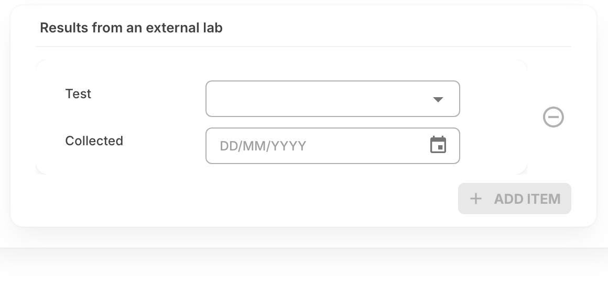

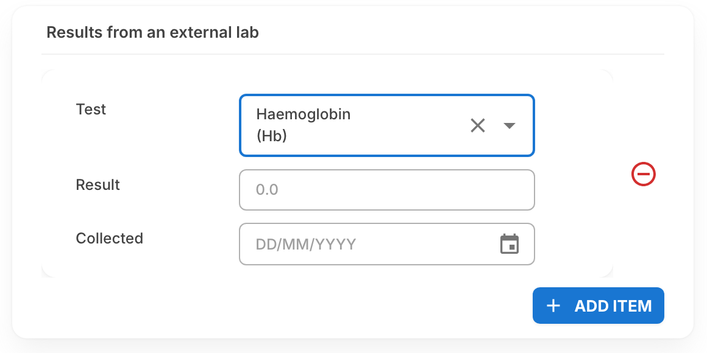

In the builder: **Advanced fields** → *Conditional method* → **enableWhen condition and behavior**. Live examples: [Storybook, *Enable When*](https://smartforms.csiro.au/storybook/?path=/story/sdc-10-1-4-behavior-other-control--enable-when).

</div>

</div>

<!--
Optional if there's time. enableWhen shows an item only when another answer matches; here, Result appears once a Test is chosen.
Disabled items are usually hidden and left out of the response, which matters for write-back.
Not in the guide's walkthrough: show the two screenshots rather than building it live. A2 and A4 lean on this heavily.
-->

---

<style scoped>table { font-size: 0.66em; } td, th { padding: 4px 10px; }</style>
<!-- _class: reference -->

## Compare with the real module

`questionnaires/modules/pam-pathology.json` has the same tree, and more:

| In the real module | What for | Where |
|---|---|---|
| `url` `.../Questionnaire/pam-pathology`, `version` `0.1.0`, `name` `PAMPathology` | identity, so the root form can pull it in | this deck |
| TSAT (`pam-tsat`) and CRP (`pam-crp`) | more tests | scenario A5 |
| hidden `pam-pathology-module` item | the section exists in the response from the start | next slide |
| `launchContext`, x-fhir-query variables, `initialExpression` | fill it in from the patient's record | Prepopulation deck |
| `templateExtract` on `pam-ext`, a contained Observation template | write the external result back | Write-back deck |
| `assemble-expectation` = `assemble-child` | it's a module of the root form | next slide |
| `pam-pathology-todo` (`display`) | the 🚧 box pointing at scenario A5 | |

<!--
Skip live: mention it's here for reading back.
If asked: the real pam-pathology module is the same tree plus identity, more tests, prepopulation and extraction, which the next two decks add.
-->

---

<style scoped>.two { grid-template-columns: minmax(0, 1fr) minmax(0, 1.2fr); } .two pre, .two pre code { font-size: 13px; } .two li, .two p { font-size: 0.72em; }</style>
<!-- _class: reference -->

## Module conventions

<div class="two">

<div>

From `questionnaires/README.md`:

- **linkIds start with `pam-`**; a module's top-level group is `pam-<module>` (`pam-pathology`).
- linkIds and variable names must be **unique across modules**: `$assemble` joins them into one form.
- Prepopulation queries sit on the module's top-level group; shared FHIRPath variables live on the root form.
- Each module has a **hidden `pam-<module>-module` item** with an initial value, so its section exists in the response from the start. From `pam-pathology.json`:

</div>

<div>

```json
{
  "linkId": "pam-pathology-module",
  "text": "Module",
  "type": "string",
  "extension": [
    {
      "url": "http://hl7.org/fhir/StructureDefinition/questionnaire-hidden",
      "valueBoolean": true
    }
  ],
  "initial": [
    {
      "valueString": "pam-pathology|0.1.0"
    }
  ]
}
```

</div>

</div>

<!--
Skip live: mention it's here for reading back.
If asked: everything starts with pam-, linkIds must be unique across modules because assembly merges them into one form.
-->

---

<style scoped>li { font-size: 0.8em; } pre, pre code { font-size: 16px; }</style>
<!-- _class: reference -->

## Modules, root form and `build.py`

- Each module is its own Questionnaire. The **root form** `pam-root.json` pulls them in with `subQuestionnaire` (by canonical `url|version`).
- **`$assemble`** joins them into the single form Smart Forms shows: `pam-assembled.json`, version `0.1.0-assembled`.
- **`modules/*.json` are generated by `build.py`.** Change `build.py`, or your edits are overwritten on the next build:

```
cd 2026-10-29/1-FHIR-For-Users/questionnaires
npm install
npm run build      # python3 build.py && node assemble.mjs
./load.sh          # PUTs modules, root and assembled form (default: Meld open endpoint)
```

- `load.sh` replaces every PAM module on Meld for everyone: pull `main` first and coordinate with a track lead, or pass your own server (`./load.sh <base>`).
- Built something in NLM Form Builder? Export R4 and copy your items into your module in `build.py`, with linkIds that follow the conventions.

<!--
Skip live: mention it's here for reading back.
The one thing to say out loud: the module JSON files are generated by build.py, so edit build.py, and coordinate before running load.sh because it replaces the shared modules.
-->

---

<!-- _class: tryit -->
<style scoped>.cards { grid-template-columns: repeat(3, 1fr); gap: 12px; } .cards > * { font-size: 0.66em; padding: 8px 12px; }</style>

## Questionnaire scenarios

<div class="cards">

<div>

### A2 GP Details ★
Choose the source (referring doctor, GP from latest admission, manual entry) with `enableWhen`.
`questionnaires/modules/pam-gp-details.json`

</div>

<div>

### A4 Past Medical / Surgical History ★★
Deep `enableWhen` trees; SNOMED CT-AU value sets.
`questionnaires/modules/pam-history.json`

</div>

<div>

### A5 Pathology Results ★★
Extend this form: MCV, B12, folate, eGFR (LOINC); repeating time points.
`questionnaires/modules/pam-pathology.json`

</div>

<div>

### A8 Patient Education ★
Multi-select delivery method and materials (`choice` + `repeats`).
`questionnaires/modules/pam-education.json`

</div>

<div>

### A10 Modular assembly ★★★
Assemble the full PAM form from A1–A9 with `subQuestionnaire` + `$assemble`.
`questionnaires/pam-root.json`, `assemble.mjs`

</div>

<div>

### A11 Patient-facing form ★★
Plain-language questions on history, diet and transfusion preferences.
Start from scratch in NLM Form Builder.

</div>

</div>

<div class="small">

Every module: `questionnaires/build.py` and `questionnaires/README.md`; this deck's form: `decks/examples/pathology-walkthrough-stage1.json`. Paths are under `2026-10-29/1-FHIR-For-Users/` in [github.com/aehrc/qh-connectathon](https://github.com/aehrc/qh-connectathon). Build in [NLM Form Builder](https://formbuilder.nlm.nih.gov/), render in the [playground](https://aehrc.github.io/qh-connectathon/smart-forms/), item types in [Storybook](https://smartforms.csiro.au/storybook). Next deck: **Prepopulation**.

</div>

<!--
These are the A-strand scenarios that only need what we just covered: start with a one-star one if you're new to this.
A5 extends exactly the form we built. A10 is the hard one: assembling every module into the full PAM form.
Next deck: Prepopulation, filling this form in from the patient's record.
-->
