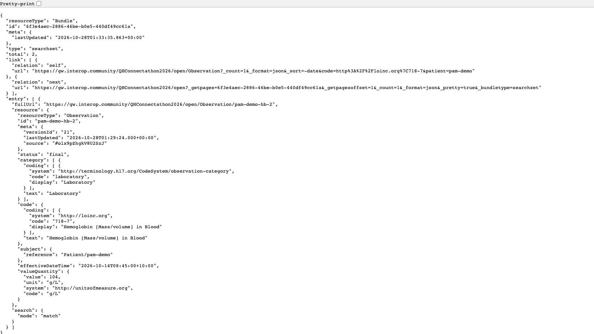
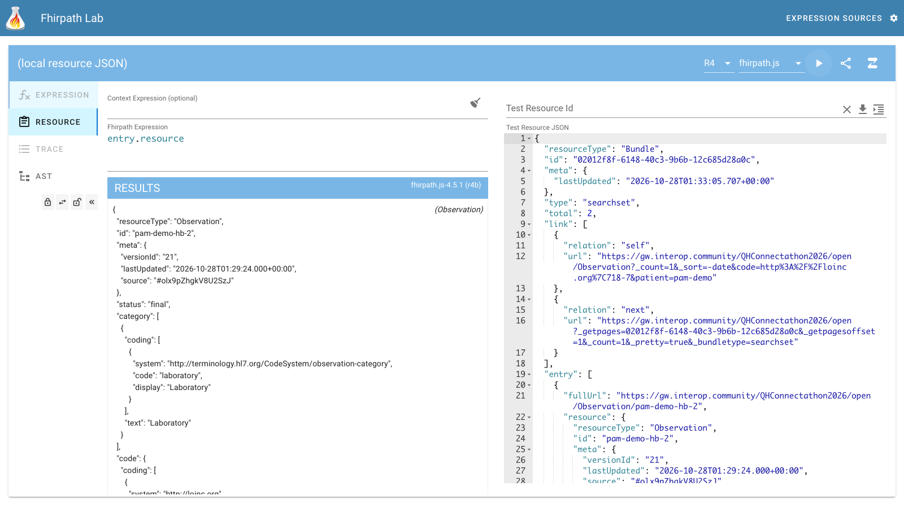
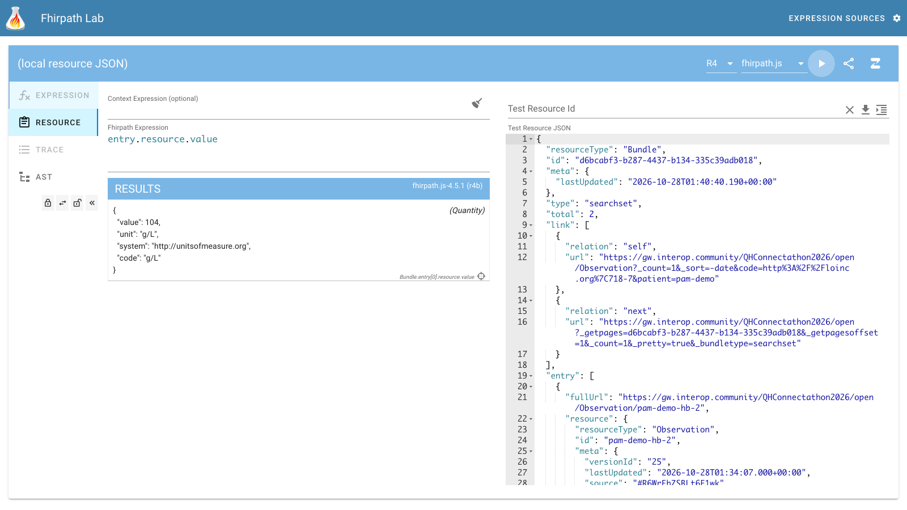
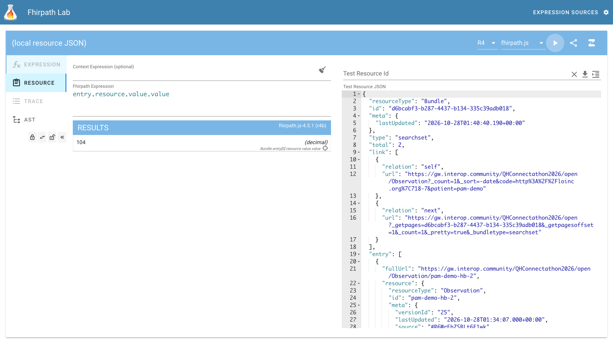
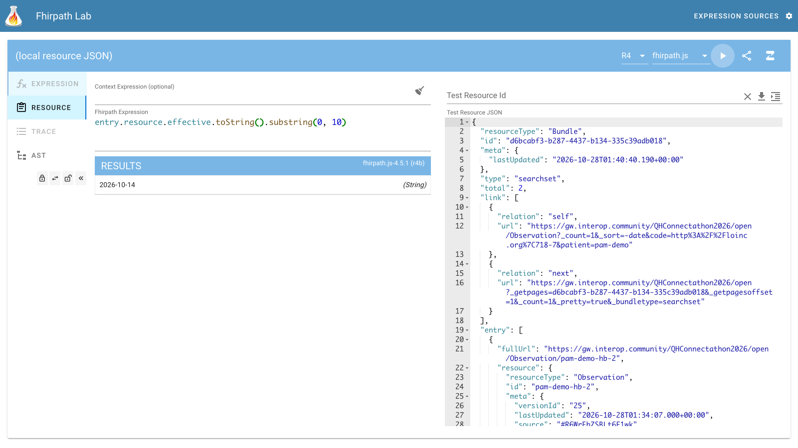
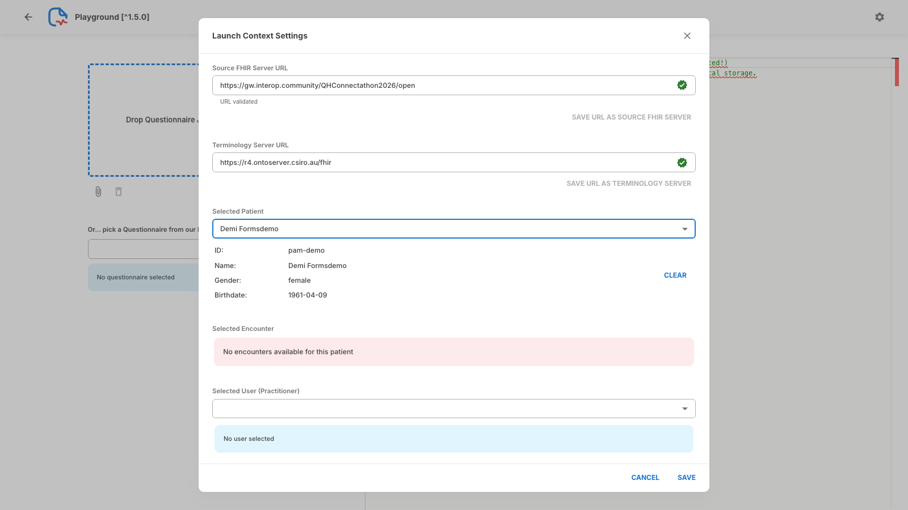
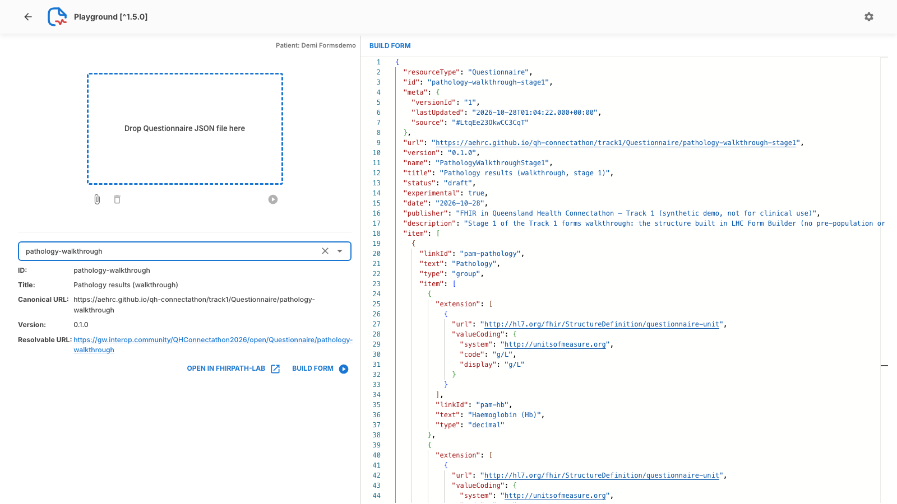
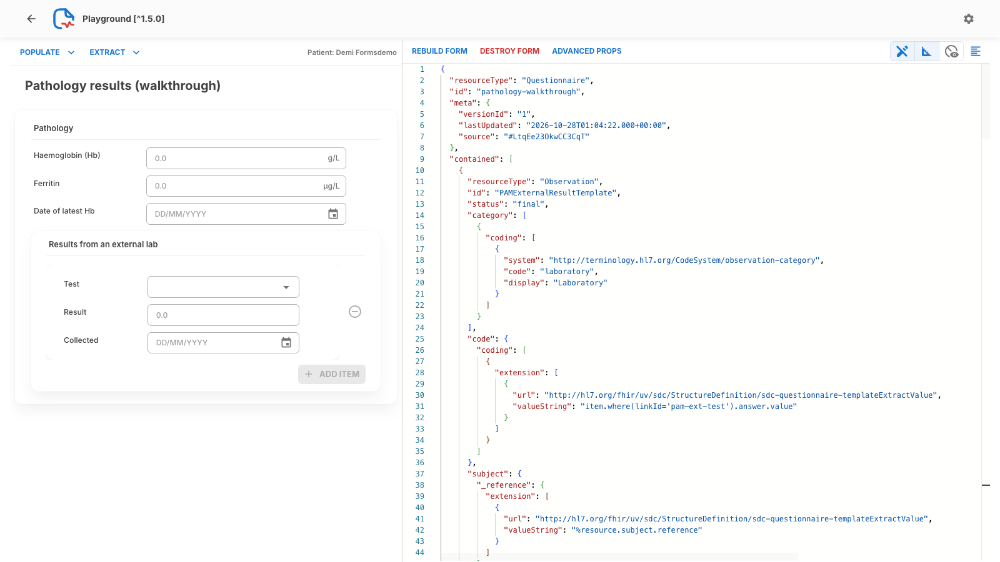
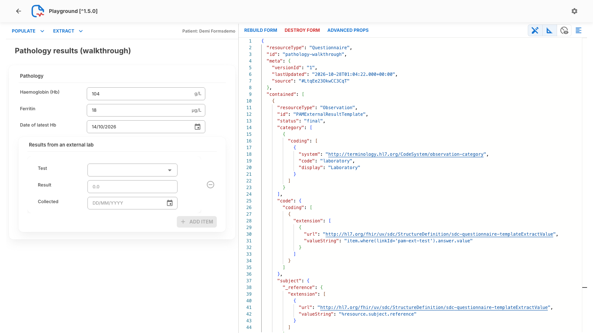

<!-- _class: title -->
<!-- _paginate: false -->
<!-- _header: "" -->

# Prepopulation

## Fill the form from the patient's record

Track 1: FHIR for Users. FHIR in Queensland Health Connectathon, 29–30 Oct 2026
Jim Steel, Leonie Dickson (AEHRC), Leon Cavalli (QH)

**Slides: aehrc.github.io/qh-connectathon/decks**

<!--
Before: run examples/reset-demo.sh so the latest Hb for pam-demo is 104 (14 Oct). Open tabs (b) the playground, (c) fhirpath-lab, (d) the latest-Hb query URL.
This deck is about not making the nurse retype what the record already knows.
About 15 minutes, mostly live.
-->

---

## Where we are

The Questionnaires deck built the structure of a cut-down **Pathology results** form (`decks/examples/pathology-walkthrough-stage1.json`). Nothing in it is filled in yet.

In this deck the form fills in **the latest Hb, ferritin and date of the latest Hb** from the patient's Observations on the FHIR server, so the nurse doesn't retype them.

- Finished form: `decks/examples/pathology-walkthrough.json`
- Same linkIds and variable names as the real module (`pam-hb`, `%latestHb`, ...)
- Demo patient: **Demi Formsdemo**, `pam-demo` (synthetic): latest Hb **104 g/L** (14 Oct 2026), ferritin **18 µg/L**
- FHIR server: Meld open endpoint `https://gw.interop.community/QHConnectathon2026/open`

<!--
We pick up the Pathology form from the Questionnaires deck: structure only, nothing filled in.
By the end, Hb, ferritin and the Hb date fill themselves from Observations on Meld.
Keeping the real module's linkIds and variable names means you can diff our cut-down form against pam-pathology.json later.
Demi Formsdemo is synthetic and shared, so others' write-backs can show up.
-->

---

## How prepopulation works: four pieces

<div class="cards" style="grid-template-columns: 1fr 1fr;">

<div>

### 1. Launch context
The form declares that it needs a **patient**. The app supplies it as `%patient`. *Extension:* `sdc-questionnaire-launchContext`

</div>

<div>

### 2. x-fhir-query variable
A FHIR search, filled in with `{{%patient.id}}`, run when the form is populated. The result Bundle becomes a variable, e.g. `%latestHb`.

</div>

<div>

### 3. FHIRPath
Picks the value you want out of that Bundle: `%latestHb.entry.resource.value.value`

</div>

<div>

### 4. initialExpression
Puts the FHIRPath result into an item as its starting answer. The user can still change it.

</div>

</div>

Build order in this deck: **run the query → build the FHIRPath in fhirpath-lab → put it in the form → populate in Smart Forms.**

<!--
Four pieces, and every prepopulated item uses all four.
Launch context says who the patient is; the query fetches data; FHIRPath picks the bit you want; initialExpression drops it into the item.
The answer is only a starting value: the user can overwrite it.
We'll go query first, then FHIRPath, then put it in the form, then run it.
-->

---

<style scoped>pre, pre code { font-size: 16px; }</style>

## 1. Launch context: "this form needs a patient"

On the **root** of the Questionnaire (from `pathology-walkthrough.json`, reformatted to fit):

```json
"extension": [
  {
    "url": "http://hl7.org/fhir/uv/sdc/StructureDefinition/sdc-questionnaire-launchContext",
    "extension": [
      {
        "url": "name",
        "valueCoding": { "system": "http://hl7.org/fhir/uv/sdc/CodeSystem/launchContext", "code": "patient" }
      },
      { "url": "type", "valueCode": "Patient" }
    ]
  }
]
```

Expressions can now use `%patient` (the Patient resource), e.g. `%patient.id` is `pam-demo`.

<!--
This sits on the root of the Questionnaire, once per form.
It's a declaration: the form needs a Patient called patient. The renderer or the EHR launch supplies it.
After that, any expression in the form can use the percent-patient variable.
-->

---

<style scoped>pre, pre code { font-size: 15px; }</style>

## 2. The query: an x-fhir-query variable

On the **top-level group** `pam-pathology` (convention): visible to this group and its items.

```json
{
  "linkId": "pam-pathology",
  "extension": [
    {
      "url": "http://hl7.org/fhir/StructureDefinition/variable",
      "valueExpression": {
        "name": "latestHb",
        "language": "application/x-fhir-query",
        "expression": "Observation?code=http://loinc.org|718-7&patient={{%patient.id}}&_sort=-date&_count=1"
      }
    },
```

The second variable, `latestFerritin`, is the same with LOINC `2276-4` (Ferritin):

```
Observation?code=http://loinc.org|2276-4&patient={{%patient.id}}&_sort=-date&_count=1
```

<!--
The query lives on the top-level group, by our module convention, so every item inside can use it.
It's a FHIR search URL with a placeholder for the patient id, filled in at populate time.
Ferritin is the same query with a different LOINC code.
-->

---

## Reading the query

```
Observation?code=http://loinc.org|718-7&patient={{%patient.id}}&_sort=-date&_count=1
```

| Part | Means |
|---|---|
| `Observation?` | search Observations |
| `code=http://loinc.org\|718-7` | LOINC 718-7, Haemoglobin [Mass/volume] in Blood (`system\|code`) |
| `patient={{%patient.id}}` | for this patient: Smart Forms replaces `{{...}}` with `pam-demo` |
| `_sort=-date` | newest first |
| `_count=1` | only the first one, i.e. the latest |

The result is a **Bundle** (type `searchset`). The variable `%latestHb` holds the whole Bundle, not the Observation.

<!--
Walk the query left to right.
Point out sort newest-first plus count 1: that's how you ask for the latest result.
Stress the last line: the variable is the whole Bundle, not the Observation. That's why the FHIRPath starts at entry.
-->

---

<!-- _class: demo -->
<style scoped>pre, pre code { font-size: 13px; }</style>

## Run the query in your browser

Paste this into the address bar of Edge or Chrome (or [open it](https://gw.interop.community/QHConnectathon2026/open/Observation?code=http://loinc.org%7C718-7&patient=pam-demo&_sort=-date&_count=1&_format=json)):

```
https://gw.interop.community/QHConnectathon2026/open/Observation?code=http://loinc.org%7C718-7&patient=pam-demo&_sort=-date&_count=1&_format=json
```

It's the form's query for `pam-demo`, with `|` written as `%7C` and `&_format=json` added (next slide says why).

You should get a `searchset` Bundle with `"total": 2` and one entry, `Observation/pam-demo-hb-2`: value **104 g/L**, `effectiveDateTime` `2026-10-14T08:45:00+10:00`.

`total` counts every match (2 Hb results); `_count=1` only limits what comes back.

<!--
Demo (guide section 2): in tab (d) paste the URL on the slide.
Expect a searchset Bundle, total 2, one entry pam-demo-hb-2, 104 g/L, effectiveDateTime 2026-10-14T08:45:00+10:00.
If you see 98 and 27 Oct, someone has done the write-back demo: rerun reset-demo.sh or just explain it.
Fallback: img/prepop/01-query-in-browser.png.
-->

---

## Gotcha: `|` and `_format=json`

<div class="cards">

<div>

### A raw `|` fails on Meld
`code=http://loinc.org|718-7` gets **HTTP 400** with no body. In an app, the browser reports it as a **CORS error**. In the address bar, or in an app or renderer that doesn't encode it, write **`%7C`**: `code=http://loinc.org%7C718-7`. Or leave the system out: `code=718-7`.

</div>

<div>

### Add `&_format=json`
Without it Meld sends XML, and Edge and Chrome **download a file** instead of showing it.

</div>

</div>

**In the form, keep the `|`.** The Smart Forms playground we use encodes it for you. Other renderers may not: if prepopulation stays empty and the browser console shows a CORS error, this is why.

**`pam-demo` is shared:** if someone has done the write-back demo you'll see their result (e.g. 98 g/L, 27 Oct) as the latest, and more than 2 results.

<!--
Two things that trip everyone up on Meld.
A raw pipe gets a 400 with no body, and in an app that looks like a CORS error, which sends people down the wrong path.
In the form itself keep the pipe: our playground build encodes it.
The format=json bit is only for viewing in a browser.
-->

---

<!-- _class: demo -->

## The Bundle

<div class="split">

<div>



</div>

<div>

What to look for:

- `"type": "searchset"`, `"total": 2`
- `entry[0].resource`: the Observation `pam-demo-hb-2`
- `effectiveDateTime`: `2026-10-14T08:45:00+10:00`
- `valueQuantity`: `104` `g/L`

Keep this tab open: you'll copy this JSON into fhirpath-lab next.

</div>

</div>

<!--
Demo: stay on the Bundle in tab (d) and point at type, total, entry[0].resource, the date and valueQuantity.
This is the structure the FHIRPath will walk.
Keep the tab open; we copy this JSON next.
Fallback: img/prepop/01-query-in-browser.png.
-->

---

<!-- _class: demo -->

## Build the FHIRPath in fhirpath-lab

Open **https://fhirpath-lab.com/FhirPath**. fhirpath-lab is for building and testing expressions.

1. In the browser tab with the Bundle: click in the page, **Ctrl+A**, **Ctrl+C**.
2. In fhirpath-lab, click in **Test Resource JSON** (right), **Ctrl+A**, paste. The header changes to *(local resource JSON)*.
3. Leave **Context Expression** empty. Type the expression in **Fhirpath Expression**.
4. Click **▶** (top right) or press **Ctrl+Enter**. **Results don't update as you type.**

Engine: leave the default, **R4 / fhirpath.js**.

Next four slides: one step at a time, from the Bundle down to the number.

<!--
Demo (guide section 3, Prepopulation step 1): click in the Bundle tab, Ctrl+A, Ctrl+C; in fhirpath-lab click in Test Resource JSON, Ctrl+A, paste. Header changes to (local resource JSON).
Leave Context Expression empty; engine stays R4 / fhirpath.js.
Remind them: nothing runs until you press the play button or Ctrl+Enter.
-->

---

<!-- _class: demo -->

## Step 1: `entry.resource`

<div class="split">

<div>



</div>

<div>

Bundle → its entries → the resource in each.

Result: the Observation `pam-demo-hb-2` (the whole resource, under **RESULTS**).

</div>

</div>

<!--
Demo (guide section 3 step 2): type the expression on the slide title, press play.
Result: the whole Observation pam-demo-hb-2.
FHIRPath walks down the tree by name, and collections flow through without loops.
Fallback: img/prepop/02-fhirpath-lab-entry-resource.png.
-->

---

<!-- _class: demo -->

## Step 2: `entry.resource.value`

<div class="split">

<div>



</div>

<div>

`value` finds `valueQuantity`: in FHIRPath a choice element is named without its type.

Result: a **Quantity**

```
{ "value": 104,
  "unit": "g/L",
  "system": "http://unitsofmeasure.org",
  "code": "g/L" }
```

</div>

</div>

<!--
Demo (step 3): add .value, press play. Result: a Quantity, 104 g/L.
Choice elements like value[x] are addressed without the type suffix, so valueQuantity is just value.
Fallback: img/prepop/03-fhirpath-lab-value.png.
-->

---

<!-- _class: demo -->

## Step 3: `entry.resource.value.value`

<div class="split">

<div>



</div>

<div>

The Quantity's own `value`: the number.

Result: **`104`** (decimal).

This is the Hb answer.

</div>

</div>

<!--
Demo (step 4): add another .value, press play. Result: 104.
Yes, value twice: the first is the Observation's value, the second is the Quantity's number.
The item already carries the unit, so we only need the number.
Fallback: img/prepop/04-fhirpath-lab-value-value.png.
-->

---

<!-- _class: demo -->

## Step 4: the date

`entry.resource.effective.toString().substring(0, 10)`

<div class="split">

<div>



</div>

<div>

`effective` is `effectiveDateTime`, `2026-10-14T08:45:00+10:00`.

A `date` item wants only `YYYY-MM-DD`, so take the first 10 characters.

Result: **`2026-10-14`** (String).

</div>

</div>

<!--
Demo (step 5): type the date expression on the slide, press play. Result: 2026-10-14, a String.
The Observation has a full date-time with time zone; a date item only wants the date part.
Substring is the quick way; there are tidier ways, and that's a good thing to explore in A5.
Fallback: img/prepop/05-fhirpath-lab-hb-date.png.
-->

---

<style scoped>pre, pre code { font-size: 16px; } table { font-size: 0.72em; }</style>

## 3 + 4. Put it in the form: `initialExpression`

In the form the Bundle is in the variable, so put `%latestHb.` (or `%latestFerritin.`) in front:

| Item | initialExpression | Gives |
|---|---|---|
| `pam-hb` | `%latestHb.entry.resource.value.value` | 104 |
| `pam-ferritin` | `%latestFerritin.entry.resource.value.value` | 18 |
| `pam-hb-date` | `%latestHb.entry.resource.effective.toString().substring(0, 10)` | 2026-10-14 |

On item `pam-hb` (next to its unit extension):

```json
{
  "url": "http://hl7.org/fhir/uv/sdc/StructureDefinition/sdc-questionnaire-initialExpression",
  "valueExpression": {
    "language": "text/fhirpath",
    "expression": "%latestHb.entry.resource.value.value"
  }
}
```

<!--
Back in the form: what you tested on the raw Bundle becomes the same expression with the variable name in front.
That's the whole translation from fhirpath-lab to the form.
The extension sits on the item, beside its unit extension.
initialExpression runs once, at populate time.
-->

---

<!-- _class: demo -->

## Smart Forms playground: server and patient

<div class="split">

<div>



</div>

<div>

Open **https://aehrc.github.io/qh-connectathon/smart-forms/** → **GO TO PLAYGROUND** (left sidebar).

1. **Gear** (top right): *Launch Context Settings*.
2. *Source FHIR Server URL*: `https://gw.interop.community/QHConnectathon2026/open` → click **?** at the right (*URL validated*) → **SAVE URL AS SOURCE FHIR SERVER**.
3. *Selected Patient*: **Demi Formsdemo** (last in the list) → **SAVE**.

</div>

</div>

<!--
Demo (guide section 4 steps 1-3): open the smart-forms link, GO TO PLAYGROUND. Gear, paste the Meld open endpoint, click ? to validate, SAVE URL AS SOURCE FHIR SERVER.
Patient: Demi Formsdemo, the last of about 42 names; scroll. SAVE.
Use our build, not smartforms.csiro.au: the public one can't reach Meld.
Fallback: img/prepop/06 and 07.
-->

---

<!-- _class: demo -->

## Pick the form and build it

<div class="split">

<div>



</div>

<div>

The header now says *Patient: Demi Formsdemo*.

4. Click the box under *Or... pick a Questionnaire from our Forms Server*.
5. Type **pathology-walkthrough** and choose it. Its details appear (version 0.1.0).
6. Click **BUILD FORM ▶** under the details.

</div>

</div>

<!--
Demo (step 4): header now reads Patient: Demi Formsdemo.
Click the forms-server box, type pathology-walkthrough, choose it; version 0.1.0 shows. BUILD FORM.
The picker lists forms on the Meld open endpoint, so participants' own forms show up here once loaded.
Fallback: img/prepop/08-playground-pick-form.png.
-->

---

<!-- _class: demo -->

## Built, but empty: now Pre-populate

<div class="split">

<div>



</div>

<div>

The form renders **empty**: the playground doesn't prepopulate on Build.

7. Click **POPULATE ▾** (top left).
8. Choose **Pre-populate (Replace whole form)**.

</div>

</div>

<!--
Demo (step 5): the form comes up empty. That surprises people: the playground doesn't prepopulate on build.
In a real launch the renderer would populate straight away.
Then POPULATE, Pre-populate (Replace whole form).
Fallback: img/prepop/09-playground-built.png.
-->

---

<!-- _class: demo -->

## Pre-populated

<div class="split">

<div>



</div>

<div>

- Haemoglobin: **104** g/L
- Ferritin: **18** µg/L
- Date of latest Hb: **14/10/2026**

The same values you got in fhirpath-lab.

The external lab group stays empty: that's for the Write-back deck.

</div>

</div>

<!--
Demo (step 6): Hb 104, ferritin 18, date 14/10/2026: the same values we got in fhirpath-lab.
That's the payoff: query, FHIRPath, initialExpression, and the form fills itself.
The external lab group stays empty; that's the write-back deck.
Fallback: img/prepop/10-playground-prepopulated.png.
-->

---

## In a real EHR: launch the form

The playground's settings dialog stands in for an EHR: it sets `%patient` without a SMART launch.

- **Real use:** the EHR **launches Smart Forms as a SMART app with a patient selected**, and the launch sets `%patient`. Meld can launch our Smart Forms build, and a launch scenario's Custom Context `questionnaire` picks the form: see `Demo-Environment.md` (Meld launch scenarios), or ask a track lead.
- **The form doesn't change:** same launchContext, queries and expressions. Only where `%patient` comes from is different.
- **Other FHIR servers:** the public playground **https://smartforms.csiro.au/playground** may not encode `|`, and it **can't reach Meld** (Meld's CORS check rejects its requests). For Meld, use our build.

<!--
The settings dialog is a stand-in for an EHR launch.
In real use the EHR launches Smart Forms as a SMART app with the patient, which is exactly the SMART apps deck.
The form itself doesn't change between the two; only where the patient comes from.
Not demoed live; point people at Demo-Environment.md if they want to try a Meld launch.
-->

---

## Calculations: `calculatedExpression`

Same FHIRPath, but **recalculated whenever the answers it uses change** (`initialExpression` runs once, at populate). BMI in `pam-patient-details.json`:

```json
{
  "url": "http://hl7.org/fhir/uv/sdc/StructureDefinition/sdc-questionnaire-calculatedExpression",
  "valueExpression": {
    "language": "text/fhirpath",
    "expression": "(%weightKg / ((%heightCm / 100).power(2))).round(1)"
  }
}
```

`%weightKg` and `%heightCm` are **shared variables on the root form** (`questionnaires/pam-root.json`), read from the `pam-weight` and `pam-height` answers. Names must be unique across modules. See "Conventions" in `questionnaires/README.md`.

<!--
Same FHIRPath machinery, different timing: recalculated whenever its inputs change.
BMI is the classic example, from the Patient Details module.
Shared variables live on the root form, so names must be unique across modules: check the conventions before you add one.
-->

---

## Gotchas

- **`|` in a query on Meld:** HTTP 400, shown as a CORS error. Use `%7C` (or `code=718-7`) in the address bar and in renderers that don't encode it. Our playground build encodes it.
- **`&_format=json`** when opening a Meld search in Edge or Chrome, or it downloads XML.
- **fhirpath-lab doesn't run as you type:** click **▶** or press **Ctrl+Enter**.
- **Test on the Bundle, use on the variable:** `entry.resource.value.value` in fhirpath-lab becomes `%latestHb.entry.resource.value.value` in the form.
- **Playground:** the form is empty until **POPULATE → Pre-populate**. For Meld use our build, not `smartforms.csiro.au/playground`.
- **Dates:** `effectiveDateTime` has a time and zone; a `date` item needs only `YYYY-MM-DD`.
- **Empty field?** Check the patient has that Observation: run the query in the browser first.

<!--
A recap people can come back to; don't read it all out.
The two that cost most time: the pipe on Meld, and forgetting to press play in fhirpath-lab.
If a field stays empty, run the query in the browser first: usually the patient just has no such Observation.
-->

---

<!-- _class: tryit -->

## Prepopulation scenarios

<div class="cards">

<div>

### A1 Patient Details ★
Pre-populate the Patient (name, date of birth, sex) and latest height and weight. Calculate age and BMI.
`questionnaires/modules/pam-patient-details.json`

</div>

<div>

### A5 Pathology Results ★★
Extend this deck's form toward the real module (TSAT, CRP) and beyond: MCV, B12, folate, eGFR (LOINC); time points.
`questionnaires/modules/pam-pathology.json`

</div>

<div>

### A6 Diagnosis + decision support ★★★
Pathway classification as `calculatedExpression`s over the pathology values and sex.
`questionnaires/modules/pam-diagnosis.json`

</div>

</div>

<div class="small">

Start from `decks/examples/pathology-walkthrough.json`. Paths are under `2026-10-29/1-FHIR-For-Users/` in [github.com/aehrc/qh-connectathon](https://github.com/aehrc/qh-connectathon). Test queries in the browser, expressions in [fhirpath-lab.com](https://fhirpath-lab.com), forms in the [playground](https://aehrc.github.io/qh-connectathon/smart-forms/). Next deck: **Write-back**.

</div>

<!--
A1 is the gentle start: same pattern on Patient fields plus height and weight, and a calculated BMI.
A5 extends today's form toward the real module.
A6 is the hard one: decision support as calculated expressions.
Then on to Write-back, or break here.
-->
