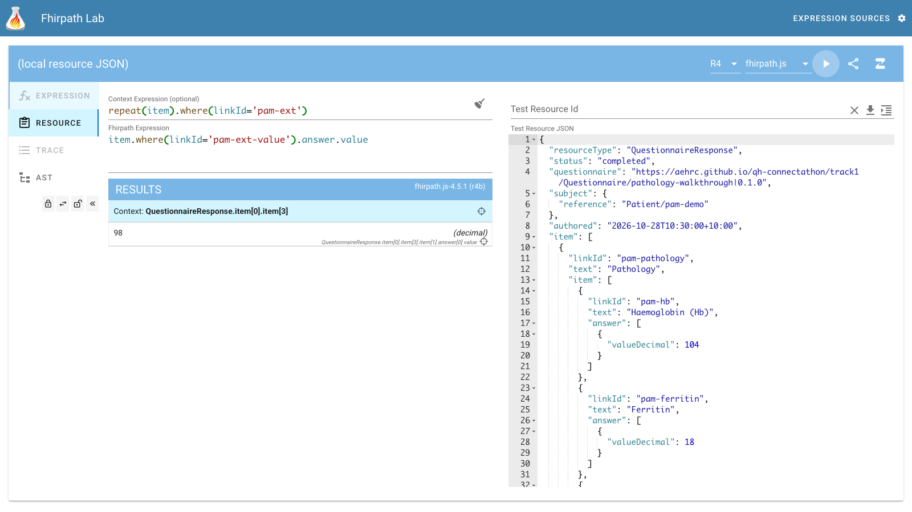
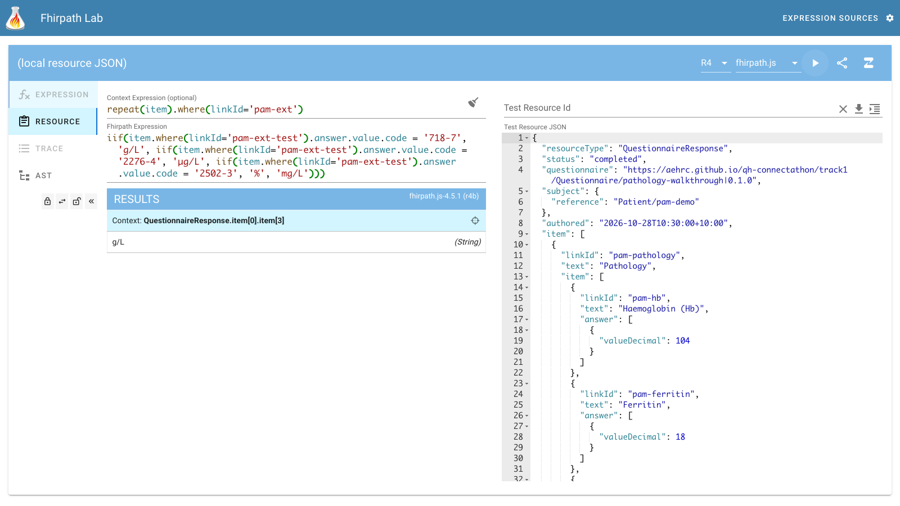
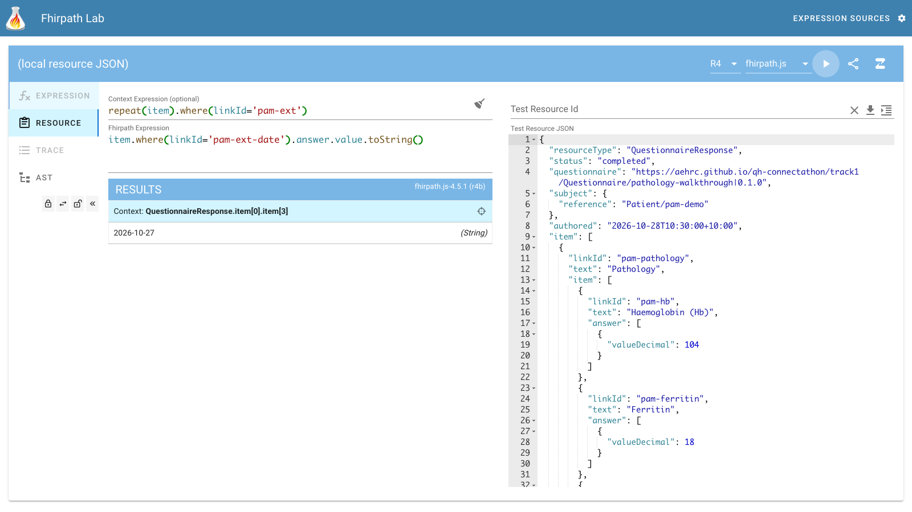
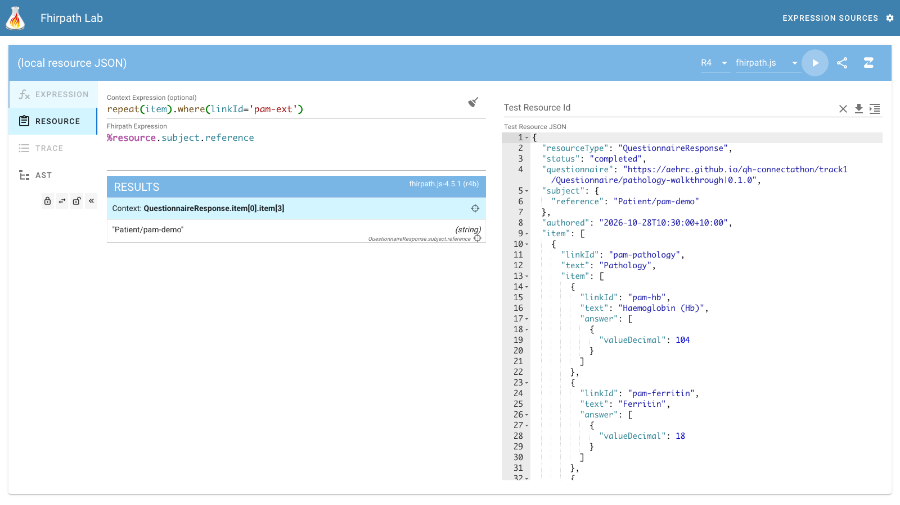
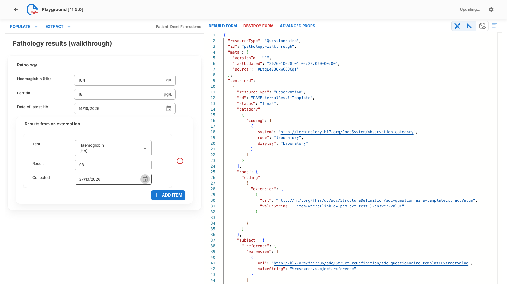
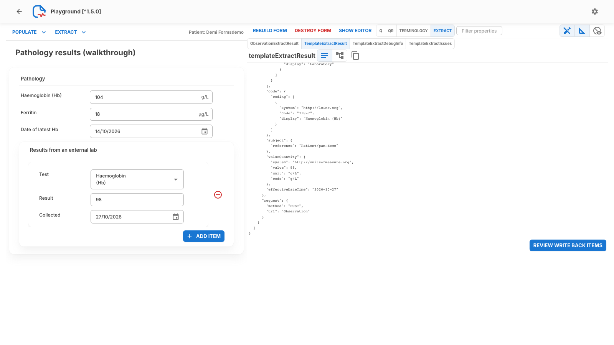
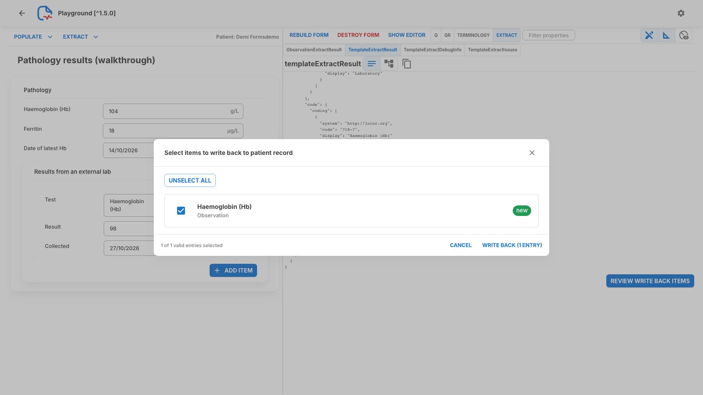
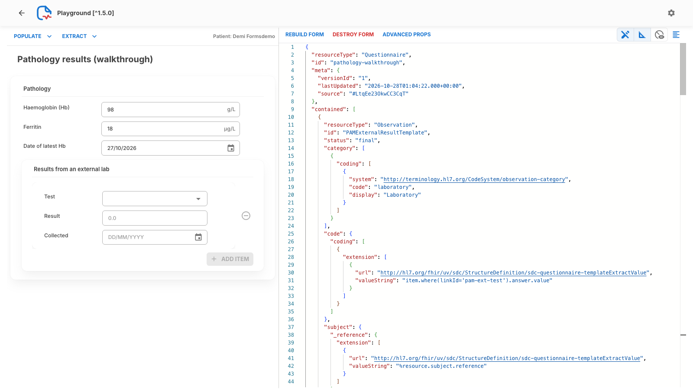

<!-- _class: title -->
<!-- _paginate: false -->
<!-- _header: "" -->

# Write-back

## From answers to FHIR resources on the server

Track 1: FHIR for Users. FHIR in Queensland Health Connectathon, 29–30 Oct 2026
Jim Steel, Leonie Dickson (AEHRC), Leon Cavalli (QH)

**Slides: aehrc.github.io/qh-connectathon/decks**

<!--
Last of the forms decks. Prepopulation read data into the form; now the form writes data back to the server.
By the end you'll have seen a typed-in result become an Observation, then come back the next time the form pre-populates.
Before starting: run examples/reset-demo.sh so pam-demo has only the baseline Hb (104).
-->

---

## Where we are

The Prepopulation deck **read** the latest Hb, ferritin and Hb date from the server into the form.

This deck goes the other way: a result the nurse **types in** (from an external lab) becomes an **Observation on the FHIR server**. Next time the form pre-populates, it finds that result.

- Same form: `decks/examples/pathology-walkthrough.json`, group **Results from an external lab** (`pam-ext`)
- Demo patient: **Demi Formsdemo**, `pam-demo` (synthetic): latest Hb **104 g/L** (14 Oct 2026)
- We'll enter an external Hb of **98 g/L** collected **27 Oct 2026**
- FHIR server: Meld open endpoint `https://gw.interop.community/QHConnectathon2026/open`

<!--
Same form and same patient as the Prepopulation deck, so nothing new to load.
The story: a nurse gets a result from an outside lab and types it in. We want that to land in the record, not just sit in the QuestionnaireResponse.
Remember the numbers: 104 on 14 Oct now, 98 on 27 Oct after write-back.
-->

---

## From answers to resources

<div class="flow">

<div>

### QuestionnaireResponse
The answers. Test **Haemoglobin (Hb)**, Result **98**, Collected **2026-10-27**.

</div>
<span>→</span>
<div>

### $extract
Template-based: copies a **template** resource from the form and fills it in with FHIRPath over the answers.

</div>
<span>→</span>
<div>

### transaction Bundle
One entry per resource made, each with `request` **POST Observation**.

</div>
<span>→</span>
<div>

### FHIR server
The app POSTs the Bundle to the server base URL. The server creates the Observation.

</div>

</div>

- The **form** says what to make: a template plus expressions. No code in the app.
- The **app** (Smart Forms) runs the extract and sends the Bundle ("write back").
- SDC also defines **Observation-based**, **definition-based** and **StructureMap-based** extract. We use **templates**: what you write is what comes out.

<!--
Read the four boxes left to right: answers, extract, Bundle, server.
The key idea: the form carries the knowledge of what to make. Smart Forms has no code that knows about Hb.
We use template-based extract because the template looks like the resource you'll get, which makes it the easiest to read and debug.
-->

---

<style scoped>p, li { font-size: 0.9em; }</style>

## The form side: `templateExtract` on the group

On the repeating group `pam-ext` (from `pathology-walkthrough.json`, reformatted, child items abridged):

```json
{
  "linkId": "pam-ext",
  "text": "Results from an external lab",
  "type": "group",
  "extension": [ {
    "url": "http://hl7.org/fhir/uv/sdc/StructureDefinition/sdc-questionnaire-templateExtract",
    "extension": [ { "url": "template", "valueReference": { "reference": "#PAMExternalResultTemplate" } } ]
  } ],
  "repeats": true,
  "item": [ ... pam-ext-test (choice), pam-ext-value (decimal), pam-ext-date (date) ... ]
}
```

- `#PAMExternalResultTemplate` points at a resource in the Questionnaire's **`contained`** list.
- `repeats: true`: the nurse can add several results. **Each repeat makes one Observation.**

<!--
Two things on the group: the templateExtract extension pointing at a contained resource, and repeats.
The # means 'look in this Questionnaire's contained list'.
One repeat makes one Observation; three results typed in give three Observations.
-->

---

<style scoped>pre, pre code { font-size: 14px; }</style>

## The template: a contained Observation (1/2)

In the Questionnaire's `contained` list. Answers fill parts with a **`templateExtractValue`** FHIRPath:

```json
{
  "resourceType": "Observation",
  "id": "PAMExternalResultTemplate",
  "status": "final",
  "category": [ { "coding": [ { "system": "http://terminology.hl7.org/CodeSystem/observation-category",
                                "code": "laboratory", "display": "Laboratory" } ] } ],
  "code": { "coding": [ { "system": "http://loinc.org", "_code": { "extension": [ {
    "url": "http://hl7.org/fhir/uv/sdc/StructureDefinition/sdc-questionnaire-templateExtractValue",
    "valueString": "item.where(linkId='pam-ext-test').answer.value.code" } ] } } ],
    "_text": { "extension": [ {
    "url": "http://hl7.org/fhir/uv/sdc/StructureDefinition/sdc-questionnaire-templateExtractValue",
    "valueString": "item.where(linkId='pam-ext-test').answer.value.display" } ] } },
  "subject": { "_reference": { "extension": [ {
    "url": "http://hl7.org/fhir/uv/sdc/StructureDefinition/sdc-questionnaire-templateExtractValue",
    "valueString": "%resource.subject.reference" } ] } },
  "_effectiveDateTime": { "extension": [ {
    "url": "http://hl7.org/fhir/uv/sdc/StructureDefinition/sdc-questionnaire-templateExtractValue",
    "valueString": "item.where(linkId='pam-ext-date').answer.value.toString()" } ] },
  "valueQuantity": "... next slide ..."
}
```

<!--
This is an ordinary Observation with holes in it. Fixed parts (status, category) are just written in.
The extracted Observation conforms to AU Core 2.0.0 Pathology Result (checked with the HL7 validator; not claimed in meta.profile).
The parts that come from answers carry an extension holding a FHIRPath expression.
Code: the LOINC code of the chosen test, and its label as code.text (the label isn't LOINC's display name, so it can't go in coding.display), subject from the QR, date from the Collected answer. Value and unit are next.
-->

---

<style scoped>pre, pre code { font-size: 14px; }</style>

## The template (2/2): `valueQuantity`

<pre class="wrap"><code>"valueQuantity": {
  "_value": { "extension": [ {
    "url": <span class="nb">"http://hl7.org/fhir/uv/sdc/StructureDefinition/sdc-questionnaire-templateExtractValue",</span>
    "valueString": <span class="nb">"item.where(linkId='pam-ext-value').answer.value"</span> } ] },
  "system": "http://unitsofmeasure.org",
  "_code": { "extension": [ {
    "url": <span class="nb">"http://hl7.org/fhir/uv/sdc/StructureDefinition/sdc-questionnaire-templateExtractValue",</span>
    "valueString": <span class="nb">"iif(item.where(linkId='pam-ext-test').answer.value.code</span> = <span class="nb">'718-7',</span> 'g/L', <span class="nb">iif(item.where(linkId='pam-ext-test').answer.value.code</span> = <span class="nb">'2276-4',</span> 'ug/L', <span class="nb">iif(item.where(linkId='pam-ext-test').answer.value.code</span> = <span class="nb">'14801-5',</span> '%', 'mg/L')))" } ] },
  "_unit": { "extension": [ {
    "url": <span class="nb">"http://hl7.org/fhir/uv/sdc/StructureDefinition/sdc-questionnaire-templateExtractValue",</span>
    "valueString": <span class="nb">"iif(item.where(linkId='pam-ext-test').answer.value.code</span> = <span class="nb">'718-7',</span> 'g/L', <span class="nb">iif(item.where(linkId='pam-ext-test').answer.value.code</span> = <span class="nb">'2276-4',</span> 'µg/L', <span class="nb">iif(item.where(linkId='pam-ext-test').answer.value.code</span> = <span class="nb">'14801-5',</span> '%', 'mg/L')))" } ] }
}</code></pre>

- `system` is fixed (UCUM). `_code` gives the UCUM code (`ug/L`), `_unit` the display (`µg/L`): they differ only for ferritin.
- The unit comes from the **chosen test**, so the Result field in the form has no unit of its own.

<!--
The unit is the fiddly bit: it depends on which test was chosen, so it's a nested iif.
Code and unit differ only for ferritin: UCUM code ug/L, display µg/L.
That's why the Result field has no unit in the form: the template decides it.
-->

---

<style scoped>pre, pre code { font-size: 16px; }</style>

## The `_` trick: extensions on primitives

In FHIR JSON a **primitive** (string, decimal, code, dateTime...) can't hold an extension itself, so its extensions go in a **sibling property with a leading `_`**:

<div class="cards" style="grid-template-columns: 1fr 1.3fr;">

<div>

### Ordinary Observation
```json
"valueQuantity": { "value": 98 }
```

</div>

<div>

### Template
```json
"valueQuantity": {
  "_value": { "extension": [ {
    "url": "...templateExtractValue",
    "valueString": "..." } ] } }
```

</div>

</div>

- In the template the primitive has **no value yet**, only the extension that computes it: `_value`, `_code`, `_unit`, `_text`, `_reference`, `_effectiveDateTime`.
- A **complex** element (a `Coding`) takes the extension directly: `"coding": [ { "extension": [...] } ]`. The answer's whole Coding replaces it.
- The extract removes the `templateExtractValue` extensions and fills in the values.

<!--
This is the bit that trips people up in FHIR JSON. A primitive like a decimal can't carry an extension itself.
So the extension sits on a sibling property with an underscore: value becomes _value.
Complex types like Coding can hold the extension directly. After the extract, the extensions are gone and the real values are in place.
-->

---

## How the extract runs

For **each repeat** of the group that has the `templateExtract`:

1. Copy the template.
2. Evaluate each `templateExtractValue` expression with **that repeat** (the `pam-ext` item in the QuestionnaireResponse) as the context. `%resource` is the **whole QuestionnaireResponse**.
3. Put the result in place of the extension. (Per SDC, an expression that returns nothing leaves the element out.)
4. Add the result to a **transaction Bundle** as an entry with `request: { method: POST, url: Observation }`.

Next: check each of these in fhirpath-lab before the form ever runs.

<!--
Four steps per repeat: copy, evaluate, replace, add to the Bundle.
Context matters: expressions run against the repeat, but %resource is the whole QR. That's how we get the subject.
An expression that returns nothing just drops that element. That's handy, but it also hides mistakes, so test first.
-->

---

<!-- _class: demo -->
<style scoped>p, li { font-size: 0.88em; } ol { margin-top: 0; }</style>

## Test the expressions in fhirpath-lab

Open **https://fhirpath-lab.com/FhirPath** (only for testing expressions; the extract runs in Smart Forms).

1. **Test Resource JSON** (right): click in it, **Ctrl+A**, paste the sample QuestionnaireResponse (next slide, or [`examples/sample-qr.json`](https://github.com/aehrc/qh-connectathon/blob/main/2026-10-29/1-FHIR-For-Users/decks/examples/sample-qr.json)). The header changes to *(local resource JSON)*.
2. **Context Expression**: paste
   ```
   repeat(item).where(linkId='pam-ext')
   ```
   The `pam-ext` repeat, as in the extract. Results show *Context: QuestionnaireResponse.item[0].item[3]*.
3. **Fhirpath Expression**: paste one template expression at a time, then **▶** (top right) or **Ctrl+Enter**. **Results don't update as you type.** `%resource` is the pasted QR. Engine: default **R4 / fhirpath.js**.

<!--
Switch to the browser, tab with fhirpath-lab. We only use it to test expressions; the real extract happens in Smart Forms.
The context expression stands in for what the extract does: it points at the pam-ext repeat.
Cue: Presenter Guide §3 'Write-back', steps 1–2. Paste examples/sample-qr.json into Test Resource JSON (Ctrl+A first), then the context expression from the slide. Expect 'Context: QuestionnaireResponse.item[0].item[3]'.
Remember results only update on ▶ or Ctrl+Enter (Surprises 6).
-->

---

<style scoped>pre, pre code { font-size: 14px; line-height: 1.3; }</style>

## The sample QuestionnaireResponse to paste

What Smart Forms makes for our answers (`examples/sample-qr.json`, compacted):

```json
{
  "resourceType": "QuestionnaireResponse",
  "status": "completed",
  "questionnaire": "https://aehrc.github.io/qh-connectathon/track1/Questionnaire/pathology-walkthrough|0.1.0",
  "subject": { "reference": "Patient/pam-demo" },
  "authored": "2026-10-28T10:30:00+10:00",
  "item": [ { "linkId": "pam-pathology", "text": "Pathology", "item": [
    { "linkId": "pam-hb", "text": "Haemoglobin (Hb)", "answer": [ { "valueDecimal": 104 } ] },
    { "linkId": "pam-ferritin", "text": "Ferritin", "answer": [ { "valueDecimal": 18 } ] },
    { "linkId": "pam-hb-date", "text": "Date of latest Hb", "answer": [ { "valueDate": "2026-10-14" } ] },
    { "linkId": "pam-ext", "text": "Results from an external lab", "item": [
      { "linkId": "pam-ext-test", "text": "Test", "answer": [ { "valueCoding":
          { "system": "http://loinc.org", "code": "718-7", "display": "Haemoglobin (Hb)" } } ] },
      { "linkId": "pam-ext-value", "text": "Result", "answer": [ { "valueDecimal": 98 } ] },
      { "linkId": "pam-ext-date", "text": "Collected", "answer": [ { "valueDate": "2026-10-27" } ] }
    ] }
  ] } ]
}
```

The `pam-ext` repeat is `item[0].item[3]`: that's what the context expression finds. Or copy [`examples/sample-qr.json`](https://github.com/aehrc/qh-connectathon/blob/main/2026-10-29/1-FHIR-For-Users/decks/examples/sample-qr.json) from GitHub (Raw).

<!--
This is what Smart Forms produces for our answers, compacted to fit. Participants can copy it from GitHub (Raw).
Point at pam-ext: item[0].item[3]. That's what the context expression found.
No need to read it all out; it's here so people can reference it later.
-->

---

<!-- _class: demo -->
<style scoped>.split p { font-size: 0.74em; } .split pre, .split pre code { font-size: 15px; }</style>

## Code: `item.where(linkId='pam-ext-test').answer.value`

<div class="split">

<div>


</div>

<div>

**Context Expression** set to the `pam-ext` repeat (*Test the expressions in fhirpath-lab*, step 2). Empty context gives no result: put the context expression and a `.` in front instead.

From the repeat → its `pam-ext-test` child → the answer's value.

Result: a **Coding**

```
{ "system": "http://loinc.org",
  "code": "718-7",
  "display": "Haemoglobin (Hb)" }
```

The template uses its `.code` (→ `code.coding[0].code`, system LOINC) and `.display` (→ `code.text`).

</div>

</div>

<!--
First expression: the test. The answer is a whole Coding; the template takes its code and its display (as code.text), because our label 'Haemoglobin (Hb)' isn't LOINC's display name and AU Core validation flags that.
Cue: Guide §3 step 3, row 1. Paste the code expression, ▶. Expect a Coding with LOINC 718-7, Haemoglobin (Hb).
Fallback screenshot: img/writeback/01-fhirpath-lab-ext-code.png.
-->

---

<!-- _class: demo -->

## Value: `item.where(linkId='pam-ext-value').answer.value`

<div class="split">

<div>



</div>

<div>

Same context.

Result: **`98`** (decimal).

It becomes `valueQuantity.value`.

`value` finds `valueDecimal` (the answer is a choice element, like `value[x]` in the Prepopulation deck).

</div>

</div>

<!--
Same pattern, different linkId. We get 98 as a decimal.
The value shortcut finds valueDecimal for us, just like value[x] in the Prepopulation deck.
Cue: Guide §3 step 3, row 2. Expect 98. Fallback: img/writeback/02-fhirpath-lab-ext-value.png.
-->

---

<!-- _class: demo -->
<style scoped>.split { grid-template-columns: 560px minmax(0, 1fr); } .split > div:first-child img { width: 560px; }</style>

## Unit: a nested `iif`

<div class="split">

<div>



</div>

<div>

Paste the `_unit` expression:

<pre class="wrap"><code><span class="nb">iif(item.where(linkId='pam-ext-test').answer.value.code</span> = <span class="nb">'718-7',</span> 'g/L', <span class="nb">iif(item.where(linkId='pam-ext-test').answer.value.code</span> = <span class="nb">'2276-4',</span> 'µg/L', <span class="nb">iif(item.where(linkId='pam-ext-test').answer.value.code</span> = <span class="nb">'14801-5',</span> '%', 'mg/L')))</code></pre>

Result: **`g/L`** (String).

Hb → g/L, ferritin → µg/L, TSAT `14801-5` → %, else mg/L (as in the real module). `_code` is the same with `ug/L`.

</div>

</div>

<!--
The long one. Paste it, don't type it. It's a lookup from LOINC code to UCUM unit.
In a real system you might use a ConceptMap or a unit on the answer option; nested iif is simple and works today.
Cue: Guide §3 step 3, row 3. Expect g/L. Fallback: img/writeback/03-fhirpath-lab-ext-unit.png.
-->

---

<!-- _class: demo -->

## Date

`item.where(linkId='pam-ext-date').answer.value.toString()`

<div class="split">

<div>



</div>

<div>

Result: **`2026-10-27`** (String).

The answer is a FHIR `date`; `.toString()` gives the text to put into `effectiveDateTime` (a date alone is a valid dateTime).

</div>

</div>

<!--
The answer is a FHIR date. toString gives text we can drop into effectiveDateTime; a date alone is a valid dateTime.
Cue: Guide §3 step 3, row 4. Expect 2026-10-27. Fallback: img/writeback/04-fhirpath-lab-ext-date.png.
-->

---

<!-- _class: demo -->

## Subject: `%resource.subject.reference`

<div class="split">

<div>



</div>

<div>

`%resource` is the **whole QuestionnaireResponse**, not the repeat, so this reaches up to the QR's own `subject`.

Result: **`"Patient/pam-demo"`** (string).

It becomes `subject.reference`. The QR's subject is the patient the form was filled for (`%patient` at populate time).

</div>

</div>

<!--
This one doesn't use the context at all: %resource reaches up to the whole QR.
The QR's subject is the patient the form was filled for, so the Observation goes to the right patient.
Cue: Guide §3 step 3, row 5. Expect "Patient/pam-demo". Fallback: img/writeback/05-fhirpath-lab-ext-subject.png.
If fhirpath-lab misbehaves, make verify runs the same expressions locally.
-->

---

<!-- _class: demo -->
<style scoped>p, li { font-size: 0.88em; } ol { margin-top: 0; }</style>

## Smart Forms playground: build and pre-populate

Same steps as the Prepopulation deck. Open **https://aehrc.github.io/qh-connectathon/smart-forms/** → **GO TO PLAYGROUND** (left sidebar).

1. **Gear** (top right). *Source FHIR Server URL*: `https://gw.interop.community/QHConnectathon2026/open` → click **?** (*URL validated*) → **SAVE URL AS SOURCE FHIR SERVER**.
2. *Selected Patient*: **Demi Formsdemo** (last in the list) → **SAVE**.
3. *Or... pick a Questionnaire from our Forms Server*: **pathology-walkthrough** → **BUILD FORM ▶**.
4. **POPULATE ▾** → **Pre-populate (Replace whole form)**: Hb **104**, ferritin **18**, date **14/10/2026**.

Write-back goes to the same Source FHIR server. The public **https://smartforms.csiro.au/playground** works for other servers but **can't reach Meld** (CORS).

<!--
Now switch to the Smart Forms playground tab. If it's still set up from the Prepopulation deck, skip straight to step 4.
Use our patched build, not smartforms.csiro.au: the public one can't reach Meld (Surprises 1).
Cue: Guide §4 steps 1–6. Gear → Source FHIR Server URL → ? → SAVE URL; patient Demi Formsdemo (last in the list) → SAVE; pick pathology-walkthrough → BUILD FORM; POPULATE → Pre-populate. Expect Hb 104, ferritin 18, 14/10/2026.
Fallback screenshots: img/prepop/06–10.
-->

---

<!-- _class: demo -->

## Fill in an external result

<div class="split">

<div>



</div>

<div>

Under *Results from an external lab*:

5. **Test**: Haemoglobin (Hb)
6. **Result**: `98`
7. **Collected**: type `27/10/2026` (DD/MM/YYYY)

**+ ADD ITEM** adds another repeat: each one becomes its own Observation.

</div>

</div>

<!--
Scroll to Results from an external lab and type in the outside result.
Note there's no unit on Result; the template works it out from the test.
Cue: Guide §4 step 7. Test Haemoglobin (Hb), Result 98, Collected 27/10/2026 (DD/MM/YYYY). Fallback: img/writeback/06-playground-filled.png.
Optionally show + ADD ITEM to make the point that each repeat becomes its own Observation, then remove it.
-->

---

<!-- _class: demo -->

## Extract

<div class="split">

<div>



</div>

<div>

8. **EXTRACT ▾** (top left) → **Template-based $extract**. Snackbar: *Successful template-based extraction*.
9. **ADVANCED PROPS** (right panel header) → tab **EXTRACT** → **TemplateExtractResult**.

The extracted Bundle: next slide.

The **QR** tab next to it shows the QuestionnaireResponse (same answers as `sample-qr.json`).

</div>

</div>

<!--
Run the extract. Nothing goes to the server yet; this only builds the Bundle.
Cue: Guide §4 steps 8–9. EXTRACT ▾ → Template-based $extract; snackbar 'Successful template-based extraction'. Then ADVANCED PROPS → EXTRACT tab → TemplateExtractResult.
Expect one POST Observation, 98 g/L, 2026-10-27. Fallback: img/writeback/08-playground-extracted-bundle.png.
-->

---

<style scoped>pre, pre code { font-size: 16px; }</style>

## The extracted transaction Bundle

**TemplateExtractResult** for our answers (abridged: `status`, `category` and the entry's `fullUrl`/ids not shown):

```json
{
  "resourceType": "Bundle",
  "type": "transaction",
  "entry": [ {
    "resource": {
      "resourceType": "Observation",
      "code": { "coding": [ { "system": "http://loinc.org", "code": "718-7" } ], "text": "Haemoglobin (Hb)" },
      "subject": { "reference": "Patient/pam-demo" },
      "valueQuantity": { "system": "http://unitsofmeasure.org", "value": 98, "unit": "g/L", "code": "g/L" },
      "effectiveDateTime": "2026-10-27"
    },
    "request": { "method": "POST", "url": "Observation" }
  } ]
}
```

The values fhirpath-lab gave; no `templateExtractValue` left. Two repeats → two entries.

<!--
Walk through the result: every value is what fhirpath-lab gave us a few slides ago, and the extensions are gone.
It's a transaction Bundle of POSTs, so the server creates new resources.
If write-back fails in the next step, stop here: this Bundle is the point; write-back is just a POST of it.
-->

---

<!-- _class: demo -->

## Write back

<div class="split">

<div>



</div>

<div>

10. **REVIEW WRITE BACK ITEMS** (bottom right). Dialog: *Haemoglobin (Hb)*, Observation, **new**.
11. **WRITE BACK (1 ENTRY)**.

Snackbar: *Write back to https://gw.interop.community/QHConnectathon2026/open successful. See Network tab for response*

The playground POSTs the Bundle to the Source FHIR server; the Observation gets a server id.

</div>

</div>

<!--
Now send it. The playground POSTs the Bundle to the Source FHIR Server from the gear settings.
Cue: Guide §4 step 10. REVIEW WRITE BACK ITEMS (bottom right) → dialog shows Haemoglobin (Hb), Observation, new → WRITE BACK (1 ENTRY). Expect the 'successful' snackbar.
Fallback: img/writeback/09-playground-write-back-dialog.png and 10-playground-write-back-ok.png.
-->

---

<!-- _class: demo -->

## Close the loop

<div class="split">

<div>



</div>

<div>

12. **POPULATE ▾** → **Pre-populate (Replace whole form)** again.

- Haemoglobin: **98** g/L (was 104)
- Date of latest Hb: **27/10/2026**
- Ferritin: still **18**

The `latestHb` query (`_sort=-date&_count=1`) now finds the new Observation: 27 Oct is later than 14 Oct.

What the form wrote, the form reads back.

</div>

</div>

<!--
The payoff. Pre-populate again and the form picks up what it just wrote.
Ferritin stays 18 because we only wrote an Hb.
Cue: Guide §4 step 11. POPULATE ▾ → Pre-populate. Expect Hb 98, date 27/10/2026. Fallback: img/writeback/11-playground-close-the-loop.png.
Afterwards run examples/reset-demo.sh (Guide §4 step 12), or the next demo starts with 98.
-->

---

## Bigger templates in the real modules

Same pattern: `templateExtract` on an item, a template in `contained`, `templateExtractValue` on the parts that come from answers.

<div class="cards">

<div>

### A6 Diagnosis → Condition
`questionnaires/modules/pam-diagnosis.json`, on the choice item `pam-diagnosis`, template `#PAMDiagnosisTemplate`.
A Condition for the chosen diagnosis (SNOMED CT-AU), with fixed clinical/verification status and category. The code is `answer.value`: the template sits on a question, not a group (Gotchas).

</div>

<div>

### A7 Treatment → MedicationRequest
`questionnaires/modules/pam-treatment.json`, group `pam-iv-iron`, template `#PAMIVIronTemplate`.
Fixed status, intent and IV route; medication from the chosen product; dose (`doseQuantity` in mg); `subject` and `authoredOn` computed; `requester` from the Prescriber item (pre-populated from `%user`).

</div>

</div>

The real `pam-pathology.json` has the same `PAMExternalResultTemplate` as our walkthrough. All three templates make resources that conform to **AU Core 2.0.0**. A6 and A7 are starting points: test new expressions in fhirpath-lab first.

<!--
Same pattern scales up. A6 makes a Condition from the diagnosis choice, A7 a MedicationRequest for IV iron.
These are the starting points for the write-back scenarios. A7's extract hasn't been run end to end in Smart Forms, so test new expressions in fhirpath-lab first.
-->

---

<style scoped>li { font-size: 0.86em; }</style>

## Gotchas

- **Test with a context.** Template expressions are relative to the repeat. In fhirpath-lab set the Context Expression `repeat(item).where(linkId='pam-ext')`, or the template expressions find nothing.
- **`%resource` is the QuestionnaireResponse**, not the repeat. Use it for things outside the group, like `subject`.
- **`_` for primitives:** `"_value": { "extension": [...] }` on a primitive, the extension directly on a complex element (`Coding`).
- **Template reference** must match the contained id with `#`: `#PAMExternalResultTemplate`.
- **`templateExtract` on a question, not a group** (a trap we fell into): the context is that question's QR item, so A6's code is `answer.value`. Our first `item.where(...)` gave a Condition with no code.
- **Playground:** the extract result is under **ADVANCED PROPS → EXTRACT → TemplateExtractResult**; write-back goes to the **Source FHIR Server** in the gear settings.
- **Shared data:** the open endpoint and `pam-demo` are shared. Every write-back stays and can become everyone's "latest Hb".
- **Nothing extracted?** Check the group has answers, the `template` reference resolves, and each expression returns a value in fhirpath-lab.

<!--
Pick the two or three that matter most: context, %resource, and the underscore.
The question-versus-group one is a real bug we hit in A6: on a question the context is that item, so the code is just answer.value.
Shared data: everyone's write-backs land on the same open endpoint and pam-demo, so expect other people's Hb values to show up.
-->

---

<!-- _class: tryit -->
<style scoped>.cards { grid-template-columns: repeat(3, 1fr); gap: 12px; } .cards > * { font-size: 0.66em; padding: 8px 12px; }</style>

## Write-back scenarios

<div class="cards">

<div>

### A5 Pathology Results ★★
Observations for results entered by hand (e.g. external lab): more tests, units.
`questionnaires/modules/pam-pathology.json`

</div>

<div>

### A6 Diagnosis ★★★
Condition (SNOMED CT-AU); Flag for limited consent; Goal for a target Hb.
`questionnaires/modules/pam-diagnosis.json`

</div>

<div>

### A7 Treatment + Ganzoni ★★★
MedicationRequest (IV iron); ServiceRequest or Appointment for the infusion.
`questionnaires/modules/pam-treatment.json`

</div>

<div>

### A8 Patient Education ★
Communication / Procedure (education given).
`questionnaires/modules/pam-education.json`

</div>

<div>

### A9 Follow-up + Status ★★
Task (follow-up); EpisodeOfCare status.
`questionnaires/modules/pam-follow-up.json`

</div>

<div>

### C1 Closed loop
Fill in A6/A7 in Smart Forms, extract the resources, and watch B4/B6 update.

</div>

</div>

<div class="small">

Start from `decks/examples/pathology-walkthrough.json` and `decks/examples/sample-qr.json`. Paths are under `2026-10-29/1-FHIR-For-Users/` in [github.com/aehrc/qh-connectathon](https://github.com/aehrc/qh-connectathon). Test expressions in [fhirpath-lab.com](https://fhirpath-lab.com), extract and write back in the [playground](https://aehrc.github.io/qh-connectathon/smart-forms/).

</div>

<!--
Hand over to the room. A5 is the gentlest start, A6 and A7 are harder, C1 joins up with the apps people.
Everything they need is on GitHub; the decks stay up for the two days.
Track leads are around to help; ask us for anything that needs Meld changes.
-->
