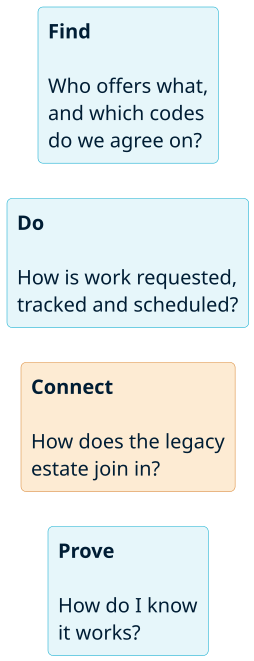
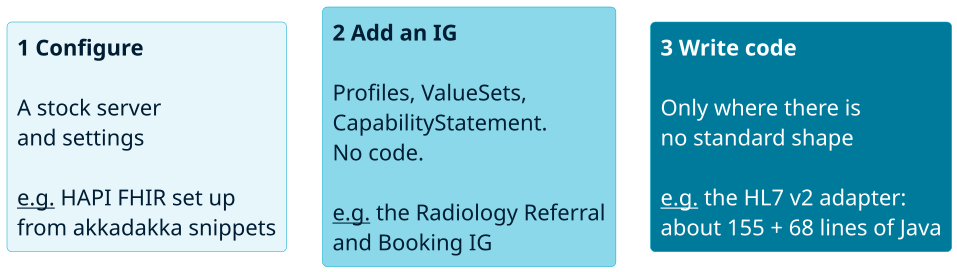
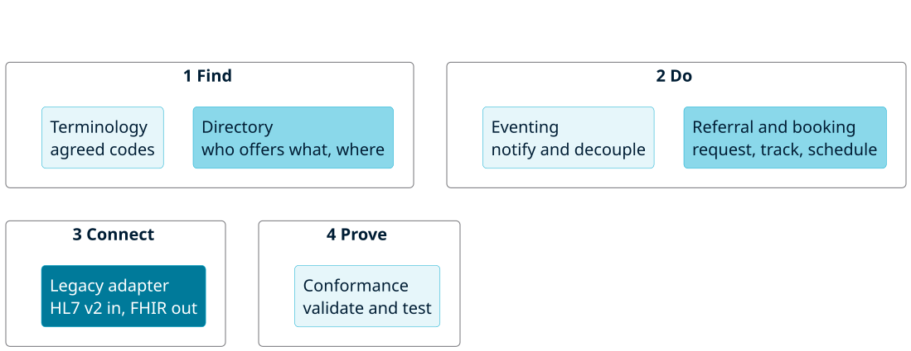
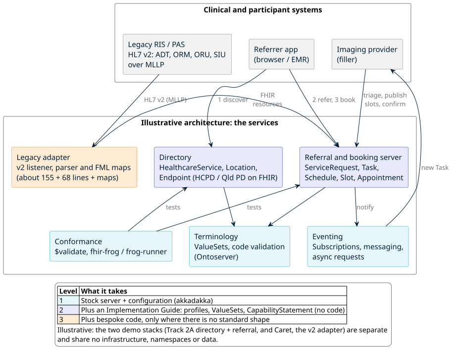

<!-- _class: lead -->
<!-- _paginate: false -->

# FHIR services for architects

## What do I need, what exists, and how does it fit?

Jörn Guy Süß · AEHRC, CSIRO
Track 2: FHIR for Services · Architecture breakout

---

## The architect's four questions

1. **Find.** Who offers what, and which codes do we agree on?
2. **Do.** How is work requested, tracked and scheduled?
3. **Connect.** How does the legacy estate join in?
4. **Prove.** How do I know it works?

And for each one: *what is there to reuse, what is mine to build, and where do I look?*

---

## Four families of service

Each family has a few ready-made services. We look at what is in each, and what it takes to use it.

---

## Three levels of effort

The colour follows the effort: the darker, the more custom work. Most of an architecture is levels 1 and 2.

---

## Six services across the four families

Pale services are configuration, mid-tone ones need an IG, the dark one needs code.

---

## How they combine (illustrative)

Illustrative: the two demo stacks (Track 2A and Caret) are separate and share no infrastructure or data.
