<!-- _class: lead -->
<!-- _paginate: false -->

# FHIR services for architects

## What do I need, what exists, and how does it fit?

Jörn Guy Süß · AEHRC, CSIRO
Track 2: FHIR for Services · Architecture breakout

---

## The architect's four questions

1. **Find.** Who offers what, and which codes do we agree on?
2. **Do.** How is work requested, tracked and scheduled?
3. **Connect.** How does the legacy estate join in?
4. **Prove.** How do I know it works?

And for each one: *what is there to reuse, what is mine to build, and where do I look?*

---

## Four families of service

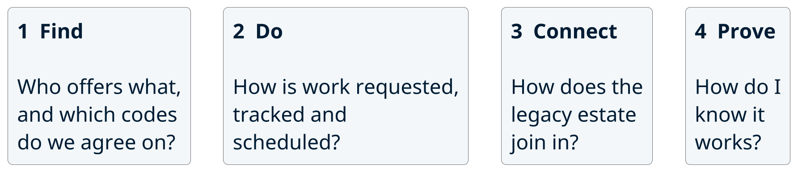

Each family has a few ready-made services. We look at what is in each, and what it takes to use it.

---

## Three levels of effort

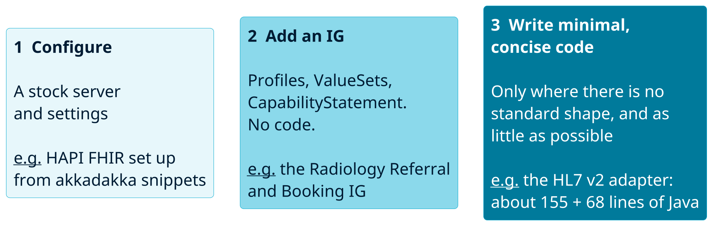

The colour follows the effort: the darker, the more custom work. Most of an architecture is levels 1 and 2.

---

## Six services across the four families

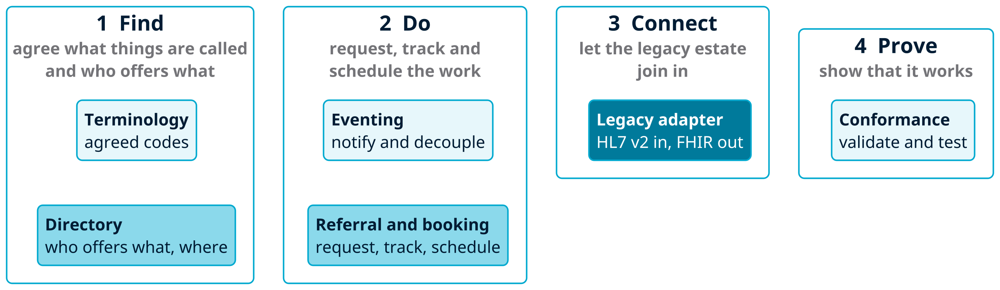

Pale services are configuration, mid-tone ones need an IG, the dark one needs a little code.

---

## How they could combine (illustrative)

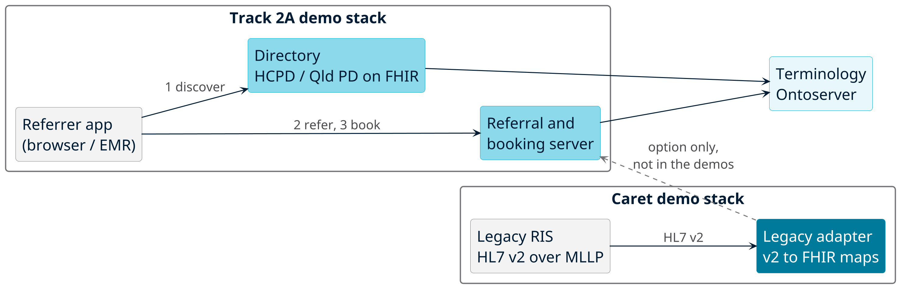

The demo stacks are separate: Track 2A and Caret share no infrastructure or data. The dashed line is a design option, not something we run.

<!--
Illustrative design: how the services could be joined in one architecture. In the demos they are not joined. Track 2A (https://ui.efiq.hospservices.net/) and Caret (https://v2.efiq.hospservices.net/) are separate stacks that share no infrastructure or data; Caret's adapter writes to its own FHIR server. The dashed line from the legacy adapter to the referral server shows what a real design could do.
-->

---

## Worked example: Caret 

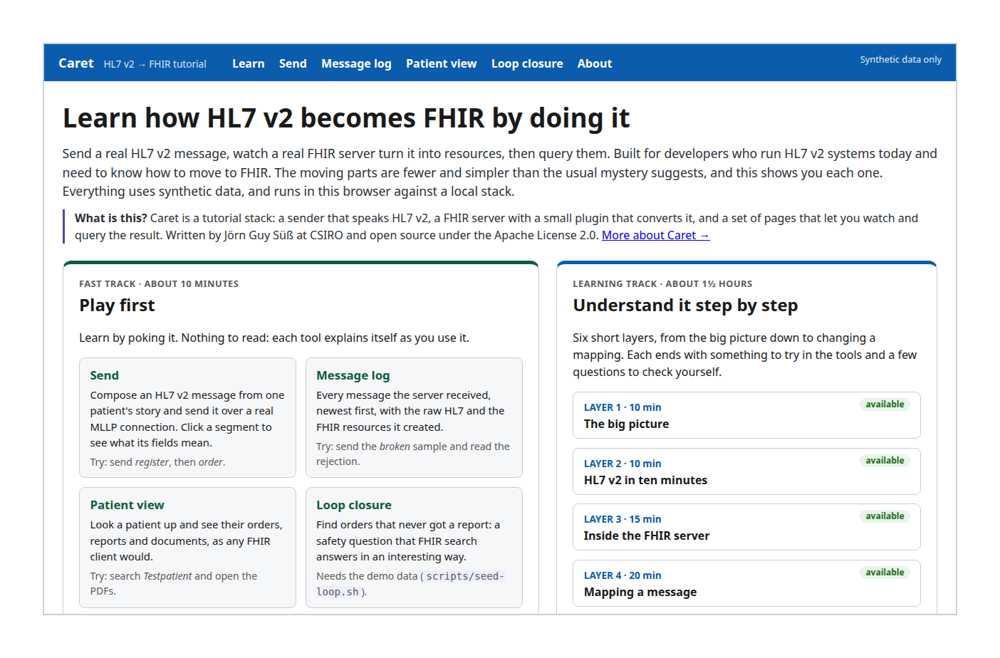

**Stock:** [HAPI FHIR](https://hapifhir.io/) server, validator, [mapping engine](https://hl7.org/fhir/mapping-language.html), storage, [Postgres](https://www.postgresql.org/).

**Ours:** a small plugin (listener 155 lines, parser 68) and maps of 45 to 105 lines each.

Apache-2.0. Synthetic data. [Source](https://gitlab.com/jgsuess-csiro/ris-hl7v2-tutorial) · [Try it live](https://v2.efiq.hospservices.net/)

<!--
Caret is a hands-on tutorial: send a real HL7 v2 message over MLLP, watch a real FHIR server turn it into FHIR resources, then read the map that did it. A small sender stands in for the RIS. Maps are written in FHIR Mapping Language. Message types: ADT A04 and A08, ORM O01, ORU R01, MDM T02, OMI O23. Source: https://gitlab.com/jgsuess-csiro/ris-hl7v2-tutorial . Live: https://v2.efiq.hospservices.net/ (up for the event, 29 and 30 Oct; fictional data only).
-->

---

## Limits of Caret 

- Reference, not a product: five message types, no authentication or TLS, one fictional hospital.
- Two defects fixed in the plugin: unescaped "^" gave AE with no audit record; a contained [Observation](https://hl7.org/fhir/R4/observation.html) showed an object name.
- Failures now get a rejected acknowledgement and an [AuditEvent](https://hl7.org/fhir/R4/auditevent.html).
- Details and code: [Caret on GitLab](https://gitlab.com/jgsuess-csiro/ris-hl7v2-tutorial).

<!--
Building Caret exposed two real faults, both fixed in the plugin (merged). An unescaped caret in a text report made the server answer AE with no audit record. A contained Observation showed an object name instead of the report text. Failed messages now get a rejected acknowledgement with a reason and an AuditEvent. Production needs authentication, TLS, more message types and monitoring; Layer 6 of the tutorial lists what. The lesson: a reader of a map can find and fix this kind of fault.
-->

---

## Which pattern answers which question [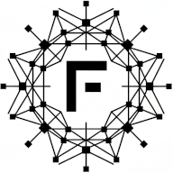](https://fhirpatterns.net/)

| Question | Pattern |
|---|---|
| Who offers this service, and where? | [Naming and Trading Service](https://fhirpatterns.net/fhir-implementation-patterns/patterns/naming-trading/) |
| How do I request work and track it? | [Asynchronous Invocation](https://fhirpatterns.net/fhir-implementation-patterns/patterns/async-invocation/) |
| How do I tell others something changed? | [Event Observer](https://fhirpatterns.net/fhir-implementation-patterns/patterns/event-observer/), [Broker](https://fhirpatterns.net/fhir-implementation-patterns/patterns/broker/) |
| How does the legacy system join in? | [Legacy Adapter](https://fhirpatterns.net/fhir-implementation-patterns/patterns/legacy-adapter/) |
| Do we mean the same codes? | [PL-09](https://fhirpatterns.net/fhir-authoring-patterns/patterns/pl-09/), [PL-10](https://fhirpatterns.net/fhir-authoring-patterns/patterns/pl-10/) |
| How do I know it works? | [PL-15](https://fhirpatterns.net/fhir-authoring-patterns/patterns/pl-15/), [PL-17](https://fhirpatterns.net/fhir-authoring-patterns/patterns/pl-17/) |

Source: [fhirpatterns.net](https://fhirpatterns.net/)

<!--
fhirpatterns.net publishes three pattern languages: FHIR Implementation Patterns, FHIR Authoring Patterns and IG Authoring Patterns. This table is the mapping used in this deck. Other implementation patterns on the site include Capability Facade and Imaging Bridge.
-->

---

## Experiments: akkadakka 

- Wiki, snippets and tutorial trail for the [HAPI FHIR JPA Starter](https://github.com/hapifhir/hapi-fhir-jpaserver-starter).
- Configuration and reuse; no HAPI code held.
- More than a dozen snippets. No snippet yet for terminology, directory or the legacy adapter.
- When configuration is not enough, small plugins on stock HAPI: [PSGC](https://gitlab.com/australian-e-health-research-centre/psgc/hapi-fhir-psgc-terminology) and [Duke UCUM](https://gitlab.com/australian-e-health-research-centre/duke-ucum/duke-ucum-fhir) (terminology), [AU Patient Summary](https://gitlab.com/australian-e-health-research-centre/au-patient-summary/hapi-fhir-au-ps), and the [HL7 v2 adapter](https://gitlab.com/australian-e-health-research-centre/hl7v2-fhir-facade/hl7v2-fhir-facade) behind Caret.
- "Activate IPS" ([International Patient Summary](https://hl7.org/fhir/uv/ips/)) leads to the [AU Patient Summary](https://hl7.org.au/fhir/ps/) plugin.
- [akkadakka on GitLab](https://gitlab.com/australian-e-health-research-centre/akkadakka)

<!--
The snippets are GitLab snippets. Each has a stock hapiproject/hapi container, an application.yaml, seed and example scripts, and a README. PSGC (geographic codes) and Duke UCUM (units) are worked examples of custom terminology plugins. The akkadakka.dev front page is live (merge request 8). Source: https://gitlab.com/australian-e-health-research-centre/akkadakka
-->

---

## Conformance checks [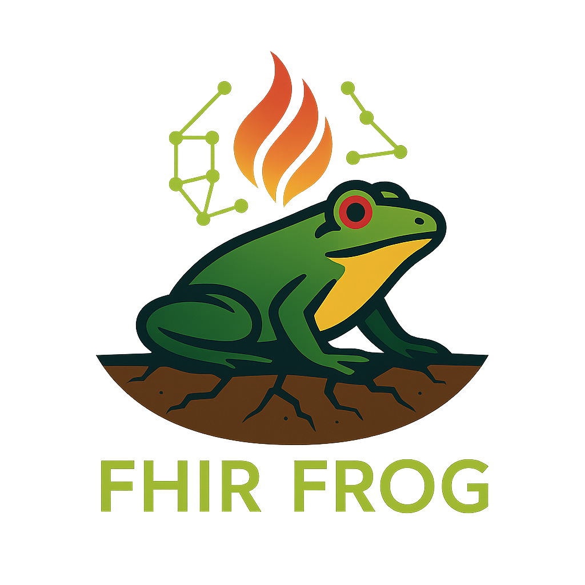](https://gitlab.com/fhirfrog/fhir-frog)

- Two layers: HAPI [$validate](https://hl7.org/fhir/R4/resource-operation-validate.html) for resources, [fhir-frog](https://gitlab.com/fhirfrog/fhir-frog) for conformance test scripts.
- [frog-runner](https://gitlab.com/fhirfrog/frog-runner) is public (early trial); a [live runner](https://conformance.efiq.hospservices.net/) is up for the event.
- Track 2 [test report](https://github.com/aehrc/qh-connectathon/blob/track2-prep-wip/2026-10-29/2-FHIR-For-Services/deploy/TEST-REPORT.md): directory bundle 1 of 1 and referral bundle 6 of 6 pass on AWS and on DiSP; 40 users for 8 minutes, no errors.
- AU eRequesting fixtures fixed for 1.0.1 ([merge request](https://gitlab.com/fhirfrog/frog-runner/-/merge_requests/6)): 7 of 7 pass, was 3 of 7.
- Patterns: [PL-15](https://fhirpatterns.net/fhir-authoring-patterns/patterns/pl-15/), [PL-17](https://fhirpatterns.net/fhir-authoring-patterns/patterns/pl-17/).

<!--
Two layers: HAPI $validate for resources, then fhir-frog test scripts. frog-runner describes itself as an early trial. Track 2 bundles pass on the AWS and DiSP stacks (report: REPORT). Validator Gate in CI is PL-15. TestScript / Inferno / Touchstone Alignment is PL-17. The AU eRequesting test package fix is merge request 6 in fhirfrog/frog-runner: https://gitlab.com/fhirfrog/frog-runner/-/merge_requests/6
-->

---

## Try it live

| [Landing page](https://track2.efiq.hospservices.net/) | [Referral app](https://ui.efiq.hospservices.net/) | [Conformance runner](https://conformance.efiq.hospservices.net/) | [Caret (HL7 v2)](https://v2.efiq.hospservices.net/) |
|---|---|---|---|
| [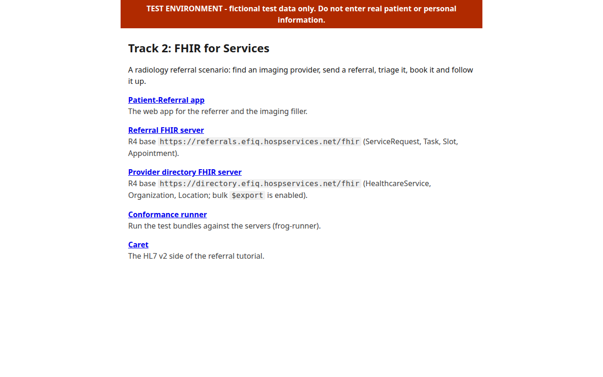](https://track2.efiq.hospservices.net/) | [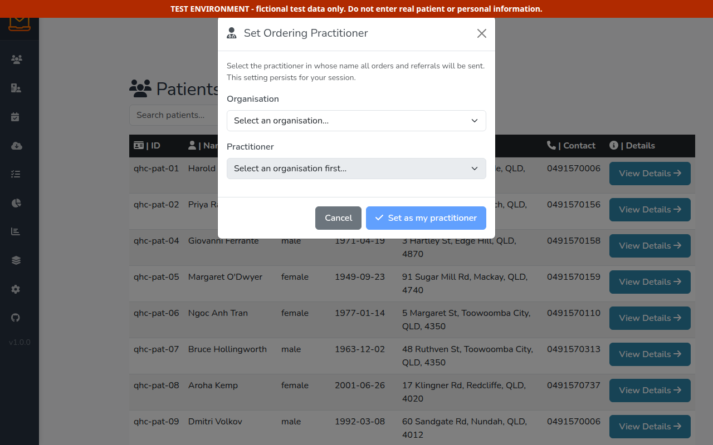](https://ui.efiq.hospservices.net/) | [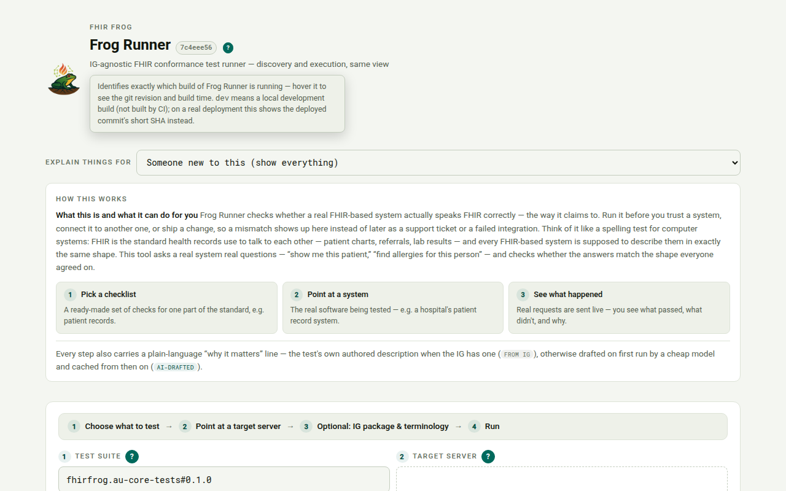](https://conformance.efiq.hospservices.net/) | [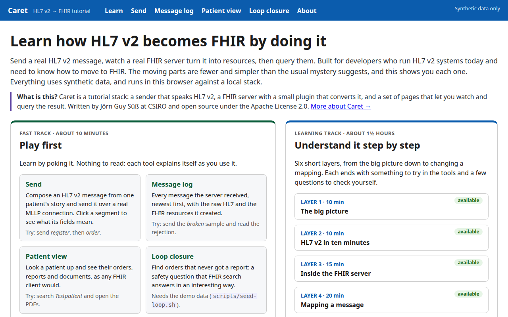](https://v2.efiq.hospservices.net/) |
|  |  |  |  |

Up for the event, 29 and 30 October. Fictional test data only. FHIR bases: [referrals](https://referrals.efiq.hospservices.net/fhir/metadata) and [directory](https://directory.efiq.hospservices.net/fhir/metadata).

<!--
Landing page https://track2.efiq.hospservices.net/ links to everything. App https://ui.efiq.hospservices.net/ . Conformance runner https://conformance.efiq.hospservices.net/ . Caret https://v2.efiq.hospservices.net/ . Referral FHIR base https://referrals.efiq.hospservices.net/fhir and directory FHIR base https://directory.efiq.hospservices.net/fhir (both answer /metadata). The stack is switched off between rehearsals; if a link does not answer, ask.
-->

---

## Where to look

| Topic | Advice | Try it | Run it |
|---|---|---|---|
| Terminology | [PL-09](https://fhirpatterns.net/fhir-authoring-patterns/patterns/pl-09/), [PL-10](https://fhirpatterns.net/fhir-authoring-patterns/patterns/pl-10/) | [PSGC](https://gitlab.com/australian-e-health-research-centre/psgc/hapi-fhir-psgc-terminology), [Duke UCUM](https://gitlab.com/australian-e-health-research-centre/duke-ucum/duke-ucum-fhir) | [Ontoserver on Docker Compose](https://github.com/aehrc/ontoserver-deploy/tree/master/docker), [public Ontoserver](https://r4.ontoserver.csiro.au) |
| Directory | [Naming and Trading](https://fhirpatterns.net/fhir-implementation-patterns/patterns/naming-trading/) | gap | [repo](https://github.com/aehrc/qh-connectathon/tree/track2-prep-wip/2026-10-29/2-FHIR-For-Services/deploy), [live](https://directory.efiq.hospservices.net/fhir/metadata) |
| Referral and booking | [Async Invocation](https://fhirpatterns.net/fhir-implementation-patterns/patterns/async-invocation/) | [snippet](https://gitlab.com/australian-e-health-research-centre/akkadakka/-/snippets/6008642) | [repo](https://github.com/aehrc/qh-connectathon/tree/track2-prep-wip/2026-10-29/2-FHIR-For-Services/deploy), [IG](https://github.com/aehrc/radiology-referral), [app](https://ui.efiq.hospservices.net/) |
| Eventing | [Event Observer](https://fhirpatterns.net/fhir-implementation-patterns/patterns/event-observer/) | [snippet](https://gitlab.com/australian-e-health-research-centre/akkadakka/-/snippets/6008651) | the [akkadakka](https://gitlab.com/australian-e-health-research-centre/akkadakka) snippets |
| Legacy adapter | [Legacy Adapter](https://fhirpatterns.net/fhir-implementation-patterns/patterns/legacy-adapter/) | [v2 adapter](https://gitlab.com/australian-e-health-research-centre/hl7v2-fhir-facade/hl7v2-fhir-facade) | [Caret](https://gitlab.com/jgsuess-csiro/ris-hl7v2-tutorial), [live](https://v2.efiq.hospservices.net/) |
| Patient summary | [International Patient Summary](https://hl7.org/fhir/uv/ips/) | [Activate IPS snippet](https://gitlab.com/australian-e-health-research-centre/akkadakka/-/snippets/4880301) | [AU-PS sample](https://gitlab.com/australian-e-health-research-centre/au-patient-summary/hapi-fhir-au-ps), [tests](https://gitlab.com/australian-e-health-research-centre/au-patient-summary/au-ps-tests) |
| Conformance | [PL-15](https://fhirpatterns.net/fhir-authoring-patterns/patterns/pl-15/) | [snippet](https://gitlab.com/australian-e-health-research-centre/akkadakka/-/snippets/4879496) | [frog-runner](https://gitlab.com/fhirfrog/frog-runner), [live](https://conformance.efiq.hospservices.net/) |

<!--
Every topic has advice. Three have no try-it snippet yet: terminology, directory and legacy adapter. Run-it for directory and referral is the Track 2 deploy folder (https://github.com/aehrc/qh-connectathon/tree/track2-prep-wip/2026-10-29/2-FHIR-For-Services/deploy); the IG is the Radiology Referral IG; conformance run-it is frog-runner.
-->

---

## Scan for the sources

| [Patterns](https://fhirpatterns.net/) | [Track 2 repo](https://github.com/aehrc/qh-connectathon/tree/track2-prep-wip/2026-10-29/2-FHIR-For-Services/deploy) | [Test report](https://github.com/aehrc/qh-connectathon/blob/track2-prep-wip/2026-10-29/2-FHIR-For-Services/deploy/TEST-REPORT.md) | [Caret](https://gitlab.com/jgsuess-csiro/ris-hl7v2-tutorial) | [akkadakka](https://gitlab.com/australian-e-health-research-centre/akkadakka) | [frog-runner](https://gitlab.com/fhirfrog/frog-runner) |
|---|---|---|---|---|---|
|  |  |  |  |  |  |

<!--
Every code opens the same page as the link above it: https://fhirpatterns.net/ , the Track 2 deploy folder (https://github.com/aehrc/qh-connectathon/tree/track2-prep-wip/2026-10-29/2-FHIR-For-Services/deploy), the test report (https://github.com/aehrc/qh-connectathon/blob/track2-prep-wip/2026-10-29/2-FHIR-For-Services/deploy/TEST-REPORT.md), https://gitlab.com/jgsuess-csiro/ris-hl7v2-tutorial , https://gitlab.com/australian-e-health-research-centre/akkadakka and https://gitlab.com/fhirfrog/frog-runner .
-->
