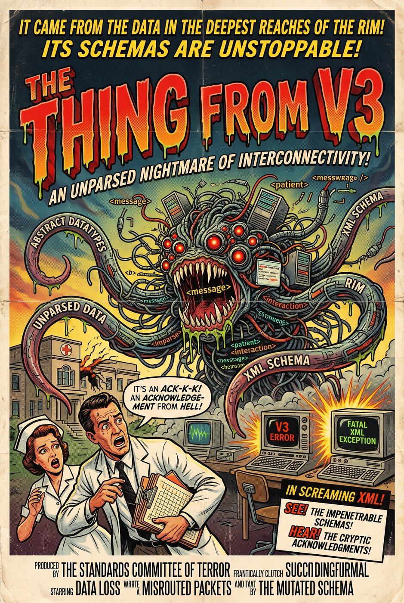

<!-- _class: lead -->
<!-- _paginate: false -->

# Caret: a message's journey into FHIR

## Hands-on: send HL7 v2, watch FHIR appear, read the map

Jörn Guy Süß · AEHRC, CSIRO
Track 2: FHIR for Services · Messaging breakout

---

## What you will do

1. **Compose** an HL7 v2 message in the browser.
2. **Send** it over a real MLLP socket and read the ACK.
3. **Watch** it validate and transform: one AuditEvent per message.
4. **Consume** the FHIR it became.
5. **Extend** it: change a map, add a message type, or build a client.

Synthetic data only. A small sender stands in for the RIS (radiology information system).

---

## Get in


**https://v2.efiq.hospservices.net/** (up for the event; fictional data only)

Source and tutorial: [Caret on GitLab](https://gitlab.com/jgsuess-csiro/ris-hl7v2-tutorial). It also runs locally with `docker compose up -d --wait`.

---

## The pieces

| Piece | Role |
|---|---|
| **Sender** (`send.html`) | Stands in for the RIS; frames messages as MLLP |
| **HL7 v2 adapter plugin** | Receives MLLP inside a stock HAPI FHIR server |
| **FHIR Mapping Language maps** | Turn each message type into FHIR resources |
| **HAPI FHIR server** | Stores the resources and the AuditEvents |
| **Pages** (`log.html`, `patient.html`, `loop.html`) | Show what happened |

Message types: ADT A04 and A08, ORM O01, ORU R01, MDM T02, OMI O23.

---

## Stage 1: compose

HL7 v2 is **pipe-and-hat** (ER7): segments (`MSH`, `PID`, `OBR`, `OBX`) carry fields in fixed positions.

```text
MSH|^~\&|RIS|HOSP|...|ADT^A04|AUTO|P|2.5
PID|1||QH000123^^^HOSP^MR||Testpatient^Tina
```

- Open `send.html` and pick the first sample, **register**.
- Hover a field to see its name. Find `PID-3` (the MRN) and `PID-5` (the name).

---

## Stage 2: send

- The browser cannot speak MLLP, so the sender frames the message (`<VT>` ... `<FS><CR>`) and delivers it over a real socket.
- You get an **ACK** back: `AA` means accepted, with the message's control id.
- `MSH-10` is `AUTO`: the sender assigns a unique control id, so **re-sending is safe**.

Try it: send **register**, read the `AA`, follow the Patient link.

---

## Stage 3: watch

Open `log.html`. Every message writes **one AuditEvent**: outcome, message type, and the raw HL7 v2.

| Send | What happens |
|---|---|
| `nonconformant` | Accepted, but a sparse PID records **validation warnings** |
| `broken` | Malformed `MSH`: rejected with `AE`, **nothing created** |

Expand a row to see the raw message. The log refreshes every 5 seconds.

---

## The patient's story: send in this order

| # | Sample | Message | Becomes |
|---|---|---|---|
| 1 | register | ADT^A04 | `Patient` (MRN `QH000123`) |
| 2 | order | ORM^O01 | active `ServiceRequest` |
| 3 | study | OMI^O23 | `ImagingStudy`, linked to the order |
| 4 | report-text | ORU^R01 | `DiagnosticReport` + `Observation`s |
| 5 | report-pdf | ORU^R01 | `DiagnosticReport` with inline PDF |
| 6 | scanned | MDM^T02 | `DocumentReference` with a PDF |

---

## The story continues

| # | Sample | Message | Effect |
|---|---|---|---|
| 7 | update | ADT^A08 | Updates the same `Patient` in place (no duplicate) |
| 8 | cancel | ORM^O01 | Revokes the `ServiceRequest` from step 2 |
| 9 | nonconformant | ADT^A04 | Accepted, with validation warnings |
| 10 | broken | (bad MSH) | Rejected `AE`, nothing created |

Because the same MRN is reused, **v2 updates and cancellations land on the right FHIR resource**.

---

## Stage 4: consume the FHIR

Open `patient.html` and search `Testpatient` (or MRN `QH000123`).


- The page shows the **FHIR request URLs** it used.
- Open the report PDF and the scanned referral (allow pop-ups if blocked).

---

## Finale: the order that never came back

The real safety risk in radiology: an order goes to a RIS, the report never returns, and **nobody sees it is missing**.

`loop.html` lists active orders older than *N* days that no final or amended report closes.

1. **One `_revinclude` query**, difference on the client:
   `ServiceRequest?status=active&authored=lt<date>&_revinclude=DiagnosticReport:based-on`
2. **The positive form with `_has`:**
   `ServiceRequest?...&_has:DiagnosticReport:based-on:status=final`

Open set = old active orders **minus** the closed ones. One order is flagged: `LOOP-OPEN-001`.

---

## Why that works

- FHIR search finds what **exists**. The safety question is about what is **missing**.
- R4 has no negative `_has`, so you take a **set difference**.
- Both queries need **literal references**: the report's `basedOn` must resolve to `ServiceRequest/<id>`.
- Early on the reports carried only a logical identifier, and both queries returned nothing. Check your references.

---

## Stage 5: extend it

Easiest first. Mapping work happens in the adapter's `ris-ingest-plugin`.

- **Add a field to a map.** Carry one more OBX/OBR field into the FHIR resource, rebuild, re-send, check `patient.html`.
- **Add a message type.** Add a route and a StructureMap, for example `ADT^A40` merge, plus a synthetic sample.
- **Build a client.** Script or notebook against the FHIR API via the sender's `/fhir` proxy: list a patient's DiagnosticReports, pull the PDFs. No credentials in this stack.

---

## What building Caret taught us

Two real faults, both fixed in the plugin (merged):

- An **unescaped caret** in a text report made the server answer `AE` with no audit record.
- A contained Observation showed an **object name** instead of the report text.

Failed messages now get a rejected acknowledgement with a reason and an AuditEvent. **A reader of a map can find and fix this kind of fault.**

---

## Limits of Caret

- Reference, not a product: five message types, no authentication or TLS, one fictional hospital.
- Production needs authentication, TLS, more message types and monitoring. Layer 6 of the tutorial lists what.
- Details and code: [Caret on GitLab](https://gitlab.com/jgsuess-csiro/ris-hl7v2-tutorial).

---

## Where to look

| Live | Source | Pattern |
|---|---|---|
| [Caret](https://v2.efiq.hospservices.net/) | [Tutorial](https://gitlab.com/jgsuess-csiro/ris-hl7v2-tutorial) | [Legacy Adapter](https://fhirpatterns.net/fhir-implementation-patterns/patterns/legacy-adapter/) |
|  |  | [HL7 v2 adapter](https://gitlab.com/australian-e-health-research-centre/hl7v2-fhir-facade/hl7v2-fhir-facade) |

---

<!-- _paginate: false -->



## One last thing

HL7 v3 was meant to tame messaging with a reference information model and XML schemas for everything.

Caret's v2 maps are small enough to read, and you can fix a fault in one. That is the point of the exercise.

*The Thing from V3: coming to a legacy interface near you.*

<!--
Run sheet (90 min): 0:00 setup; 0:10 compose and send; 0:25 watch; 0:45 consume; 1:05 extend and loop-closure finale; 1:25 wrap-up. The stack is switched off between rehearsals; if the link does not answer, ask.
-->
