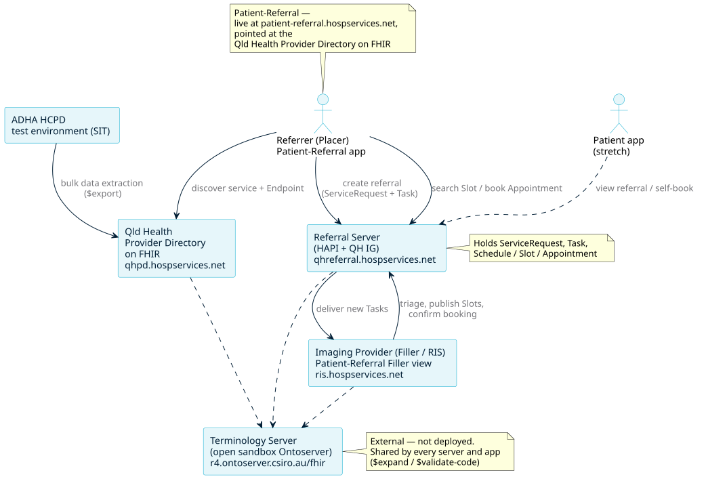
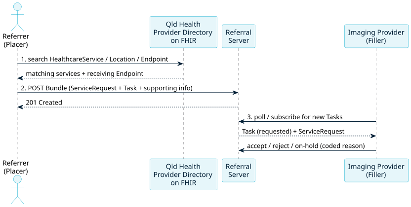
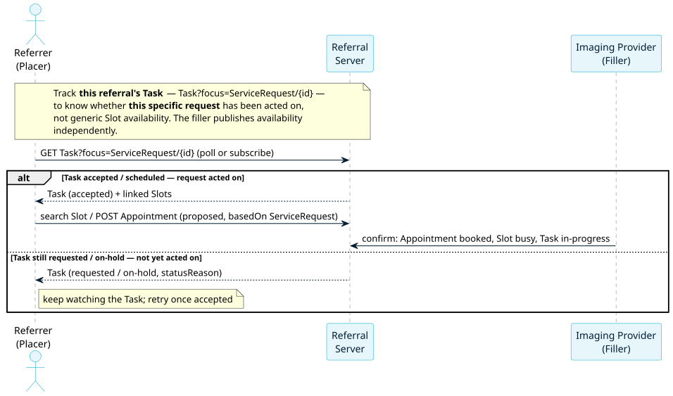
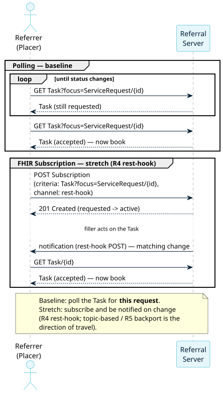
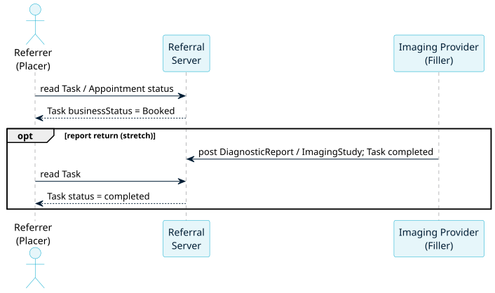

<!-- _class: lead -->
<!-- _paginate: false -->

# FHIR for Services — Track 2A

## 2A: Provider Directory and Workflow Services

FHIR in Queensland Health Connectathon | October 2026

Track leads: Daniel Foulkes · Joern Guy Süß · Michael Osborne

---

## 2A: Provider Directory and Workflow Services

Led by Michael Osborne, this stream focuses on **referral and workflow orchestration patterns using FHIR services**. Activities may include:

- Discovering services using an example `Qld Health Provider Directory on FHIR`
- Creating and managing ServiceRequests, Task and Appointment using a Patient Referrals demo app 
- Exploring FHIR referral workflows and provider discovery 
- Developing FHIR profiles and implementation guide content to support workflow interoperability
- Testing end-to-end workflow scenarios using real-world Queensland Health use cases

---

## What do we mean by services? 

Services is an overloaded word...

### What kinds of information services are part of a health ecosystem?

- *Identity* - PAS, EMPI, National e.g. Provider Directory, Services Australia, Heath Direct
- *Records* - iEMR, LIS (e.g. AUSLAB), RIS (e.g. Karisma), PACS, Pharmacy, Theatre...
- *Terminology* - QCTS, NCTS, AIHW Meteor, ABS, Proprietary (e.g. MIMS), Local codes 
- *Integration* - Rhapsody, eGate ...
- *Consent* - Patient consent management for many use cases 

### What kind of health services can we link up and create FHIR workflows for

- *Requesting* - Pathology and Radiology
- *Reporting* - Diagnostics, Discharge Summary, Patient Apps
- *Referrals* - Any Healthcare service you can name. Ideas ?   

---

## What we are building

An **end-to-end radiology referral** workflow. A referrer:

1. **Discovers** a suitable imaging service in our demo of `Qld Health Provider Directory on FHIR`
2. **Creates** a FHIR referral — `ServiceRequest` + `Task` with supporting information
3. **Books** an appointment against slots the imaging provider publishes

…with the referral **status tracked through a Task** until the appointment is confirmed.

> Learn core FHIR resources and workflow concepts.

---

## Why this scenario

- **Realistic and manageable** — relevant to Queensland Health participants
- Exercises **Patient, Provider, ServiceRequest, Task, Schedule, Slot, Appointment** in one flow
- Complements QH's existing smart-referral capabilities
- Builds on existing HL7 AU eRequesting workflow prototypes and provider-directory concepts

---

<!-- _class: split -->

## Systems and roles

- **Referrer** — Patient-Referral at `ui.efiq.hospservices.net`: the browser-core path for discover → refer → track
- **Directory** — Qld Health Provider Directory on FHIR at `directory.efiq.hospservices.net/fhir`, loaded from the [ADHA HCPD test environment (SIT)](https://sit.healthconnect.digitalhealth.gov.au/adha/hcd-api-router/api/v1/fhir) via [HCPD bulk data extraction](https://implementer.digitalhealth.gov.au/fhir/hcpd/current/bulk-data-extraction.html)
- **Referral Server** — HAPI + QH IG at `referrals.efiq.hospservices.net/fhir`
- **Filler / RIS** — imaging provider at `ris.efiq.hospservices.net`
- **Terminology** — external open sandbox Ontoserver at [`r4.ontoserver.csiro.au/fhir`](https://r4.ontoserver.csiro.au/fhir), used for `$expand` / `$validate-code`

---

## The flow — 1. Discover & request

Search the directory → raise the referral (ServiceRequest + Task) → filler triages.

---

## The flow — 2. Track this request & book

Monitor **this referral's Task** to know when it has been acted on, then book.

---

## Tracking: poll vs subscribe

**Baseline:** poll the Task for this request. **Stretch:** a FHIR Subscription
(R4 rest-hook) pushes a notification on change — no polling.

---

## The flow — 3. Confirm & complete

Track status through to **Booked**; report return closes the Task (stretch).

---

## Standards in scope

- **[AU Core](https://build.fhir.org/ig/hl7au/au-fhir-core/)** — Patient, Practitioner, PractitionerRole, Organization, Condition, Observation
- **[AU eRequesting](https://build.fhir.org/ig/hl7au/au-fhir-erequesting/)** — imaging ServiceRequest, Group + fulfilment Task (baseline to align with)
- **[QH FHIR Referrals IG](https://aehrc.github.io/radiology-referral/)** — QH extensions: referral category, urgency, facility identifiers
- **[ADHA Provider Directory IG](https://implementer.digitalhealth.gov.au/fhir/hcpd/26.0.0/index.html)** — directory resources and search 
- **FHIR R4 Scheduling** — Schedule, Slot, Appointment
- *Bulk Data Access IG* — Qld Health Provider Directory on FHIR `$export` (stretch)

> Profiles for this scenario: the **Radiology Referral and Booking IG** — `github.com/aehrc/radiology-referral` (builds on AU eRequesting 1.0.1) can be viewed [here](https://aehrc.github.io/radiology-referral).

---

## Two streams, run in parallel

### Browser core path
- Qld Health Provider Directory on FHIR queries, referral creation and booking via a client (Postman / Bruno / test harness)
- Right for less-technical participants and anyone with locked-down laptops

### Developer deep dive (~10 people)
- Local tooling, extending the workflow, validation and state management
- Laptop permissions and prerequisites shared **before** the event

---

## Day 1 — Thursday 29 October

| Time | Focus |
|------|-------|
| 11:30–13:00 | **Kick-off & environment** — scenario intro, roles, Qld Health Provider Directory on FHIR connectivity, seed data; split streams |
| 14:00–15:00 | **Discovery** — Qld Health Provider Directory on FHIR queries; resolve the receiving Endpoint |
| 15:30–17:00 | **Referral creation** — ServiceRequest + Task Bundle; `$validate` on HAPI |

*(Plenaries 9:00–10:30, morning tea 11:00, lunch 13:00, afternoon tea 15:00.)*

---

## Day 2 — Friday 30 October

| Time | Focus |
|------|-------|
| 9:30–10:30 | **Filler triage & availability** — accept / reject / on-hold; publish Slots |
| 11:00–12:30 | **Booking** — Appointment, confirm, cancel & rebook, negative tests |
| 13:30–15:00 | **Status tracking** end-to-end + stretch goals |
| 15:30–16:30 | **Show and Tell!** — demo the full flow |

*(Recap 9:00, morning tea 10:30, lunch 12:30, afternoon tea 15:00, close 16:30.)*

---

## Getting started

- **Servers** To be confirmed — open FHIR endpoints with some test data
- Bring your laptop, synthetic data, and your ideas — nothing sensitive!
- Validate against the QH IG or AU eRequesting with `$validate` operation

---

## Open for debate

- **Are we solving an already solved problem?** - What about QH Smart Referrals and the Healthdirect (NHSD) API?
- **What kinds of service have an endpoint?** — test endpoints in the Qld Health Provider Directory on FHIR: V2, FHIR other.
- **Who books?** — referrer directly, or filler after triage (support both?)

> Tracked as GitHub issues on the `track:services` label.

---

<!-- _class: lead -->
<!-- _paginate: false -->

# Let's build it

## Questions, ideas, and let's FHIR it up

Repository: `github.com/aehrc/qh-connectathon` → `2026-10-29/2-FHIR-For-Services`

IG: `github.com/aehrc/radiology-referral`

IG Build: `https://aehrc.github.io/radiology-referral/`

Referrer app: `ui.efiq.hospservices.net`

Servers: directory `directory.efiq.hospservices.net` · referral `referrals.efiq.hospservices.net` · RIS `ris.hospservices.net` · terminology `r4.ontoserver.csiro.au/fhir`
