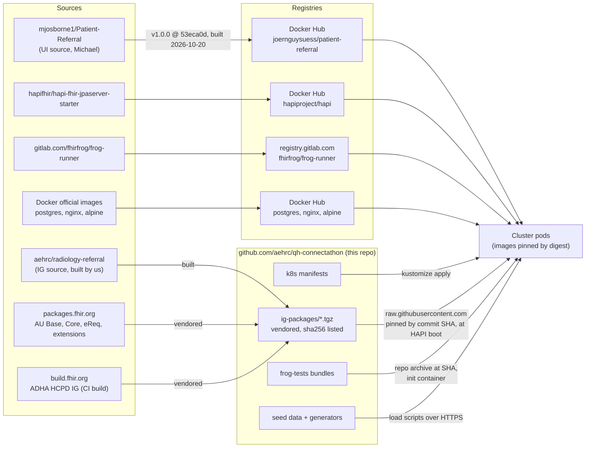
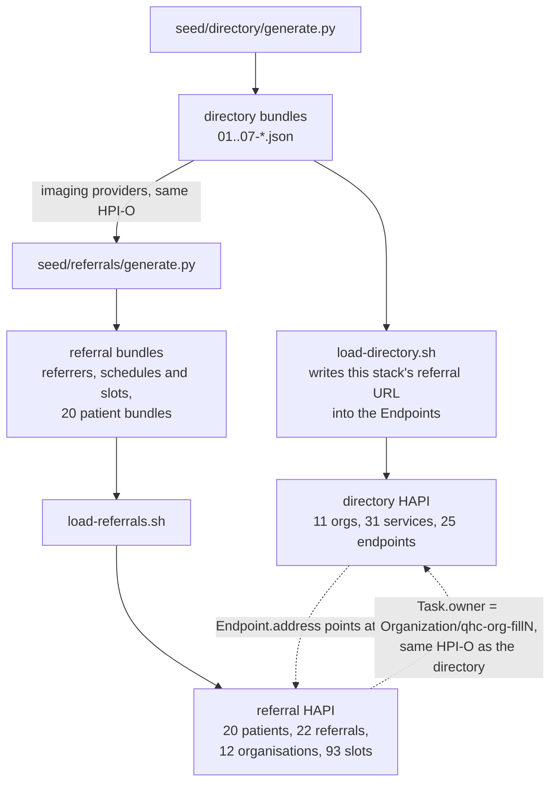
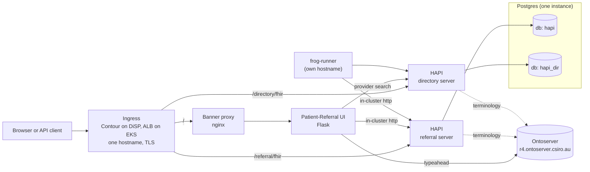
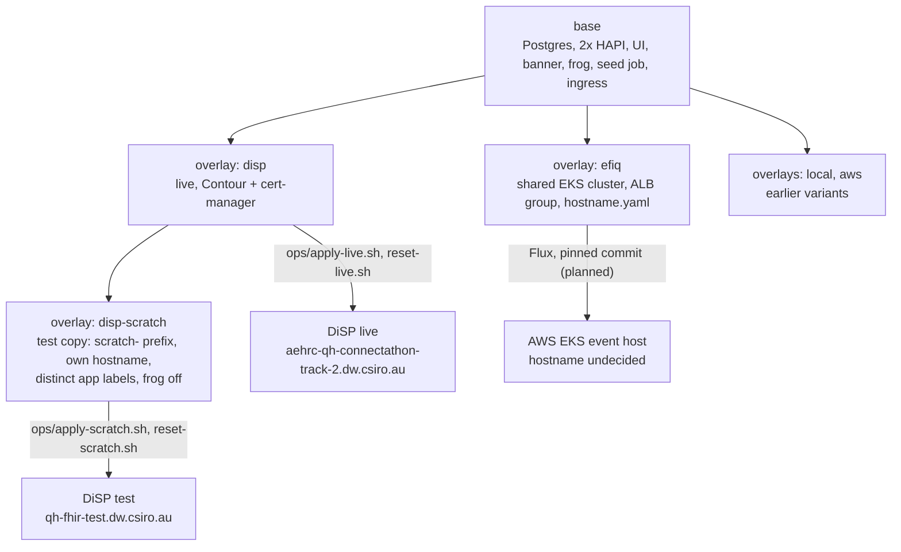
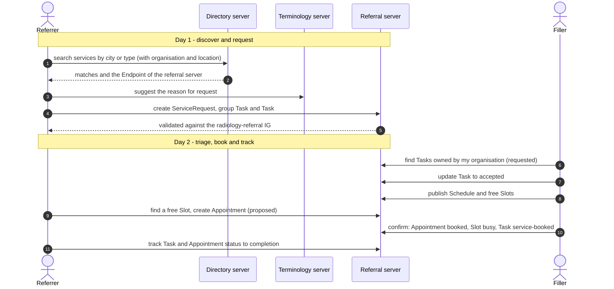
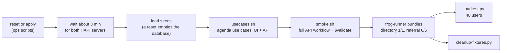

# Track 2 deployment: what runs where, and where every part comes from

Status as of 2026-10-20. This is the authoritative description of the deployed stack. `Deployment-Design.md` is the original design
sketch (kept for history); `IG-PINNING.md`, `DIRECTORY-CONTEXT-PATH.md`, `EKS-PLAN.md`, `loadtest/README.md` and `ops/README.md` hold the
detailed findings this document summarises.

Quick orientation:
1. Where the parts come from (section 1) and the packages and data (sections 2 and 3).
2. Hosts and routing (4), repositories (5), how it is deployed (6), how it is verified (7), how to run it (8).

## 1. Where the parts come from

How a part gets from its source to a running pod (the table below gives the detail for each):



| Part | What it is | Comes from | Pinned to | Licence |
|---|---|---|---|---|
| **Patient-Referral UI** ("the app") | Flask web app: referrer and filler screens, provider search, dashboards | Source: [github.com/mjosborne1/Patient-Referral](https://github.com/mjosborne1/Patient-Referral) (Michael Osborne). Image we run: `docker.io/joernguysuess/patient-referral:1.0.0-53eca0d` (app v1.0.0, commit `53eca0d`; `/version` reports it), built on 2026-10-20 | digest `sha256:2a1d0ad7…` | MIT |
| **HAPI FHIR server** (x2: referral and directory) | The two FHIR servers (R4), HAPI 8.12.0 | [hapifhir/hapi-fhir-jpaserver-starter](https://github.com/hapifhir/hapi-fhir-jpaserver-starter), image `docker.io/hapiproject/hapi` | digest `sha256:d7f38d36…` | Apache-2.0 |
| **Postgres** | One instance, two databases (`hapi` for referral, `hapi_dir` for directory) | Docker official image `postgres:16` | digest `sha256:e17e8606…` | PostgreSQL licence |
| **Terminology server** | `$expand` / `$validate-code` for SNOMED CT-AU and ValueSets; the one external dependency | `https://r4.ontoserver.csiro.au/fhir` (CSIRO Ontoserver, public) | n/a (shared service) | n/a |
| **"Test data only" banner** | nginx proxy that injects the banner into the UI's pages | `nginxinc/nginx-unprivileged:1.27-alpine`; the config is `k8s/base/35-banner.yaml` | digest `sha256:65e3e85d…` | BSD-2-Clause |
| **frog-runner** | Conformance test runner and web UI | [gitlab.com/fhirfrog/frog-runner](https://gitlab.com/fhirfrog/frog-runner), image `registry.gitlab.com/fhirfrog/frog-runner` (public) | digest `sha256:9342e291…` (build 7c4eee56, 2026-10-13) | Apache-2.0 |
| **frog test bundles** | The two conformance bundles (directory step 1; referral steps 2 to 6) | `deploy/frog-tests/` here, adapted from the Sparked 2026-07-08 Connected Scenario 1 tests | fetched at commit `3bd64c5` by an init container | CC BY-NC-SA 4.0 (this repo) |
| **Implementation guides and profiles** | see section 2 | see section 2 | by commit SHA in this repo | see section 2 |
| **Seed data** | Fictional directory and referral data | Generated by scripts in this repo, see section 3 | in git | CC BY-NC-SA 4.0 (this repo) |
| **Manifests** | Kustomize `base` + overlays | `deploy/k8s/` in this repo | git | CC BY-NC-SA 4.0 |

The UI image has no source-commit label, so which commit of Patient-Referral it contains is not recorded. It predates Michael's
2026-10-08 commits (the HCPD import and the booking / imaging-filler screens), so those screens are not in the deployed UI.
Label the next build with the git SHA.

## 2. Implementation guides and packages

HAPI does **not** fetch dependencies for packages given by URL, so every package is listed explicitly, in order, with
`FETCHDEPENDENCIES=false`. The tarballs are committed in `deploy/ig-packages/` (checksums in `SHA256SUMS`) and served to the pods
from this public repo by **commit SHA** (`raw.githubusercontent.com/aehrc/qh-connectathon/<sha>/...`), so the event does not depend on
`build.fhir.org` or the package registry being up or unchanged.

| Package | Version | Original source | Licence | Loaded on |
|---|---|---|---|---|
| `au.csiro.aehrc.track2-v2-0203` | 0.1.0 | our extract of CodeSystem v2-0203 (147 concepts, unmodified) from `hl7.terminology.r4` 7.0.1 | CC0 | both |
| `hl7.fhir.uv.extensions.r4` | 5.3.0 | packages.fhir.org | CC0 | both |
| `hl7.fhir.au.base` | 6.0.0 | packages.fhir.org | CC0 | both |
| `hl7.fhir.au.core` | 2.0.0 | packages.fhir.org | CC0 | both |
| `hl7.fhir.au.ereq` (AU eRequesting) | 1.0.1 | packages.fhir.org | CC0 | referral |
| `au.csiro.aehrc.referral` (**Radiology Referral and Booking IG**) | 0.1.0 | built by us from [github.com/aehrc/radiology-referral](https://github.com/aehrc/radiology-referral) (submodule `ig/`); not published anywhere | CC0 | referral |
| `au.gov.digitalhealth.fhir.hcpd` (ADHA Provider Directory IG) | 26.0.0 (CI build 20260908231611) | `build.fhir.org/ig/AuDigitalHealth/HCPD/package.tgz` (not on any registry; the version label is reused by every CI rebuild, hence the vendored copy) | CC BY 4.0 | directory |

Deliberately **not** loaded: the full `hl7.terminology.r4` package (4.7 MB, vendored for reference). It makes HAPI save thousands of
concepts and reindex in the background and pinned both servers at their CPU limit; the 20 KB extract gives the same validation result.
`hl7.fhir.au.pd` 2.0.1 is vendored for reference only (it conflicts with AU Base 6.0.0).

## 3. Data

All data is **fictional**. Generators are in the repo and deterministic, so the committed JSON can always be regenerated.

| Data | Generator and files | Contents |
|---|---|---|
| **Directory** (the HCPD stand-in) | `seed/directory/generate.py` writes `seed/directory/01..07-*.json` (FHIR transaction bundles); `seed/load-directory.sh` loads them | 11 organisations, 16 locations, 31 services (28 imaging), 36 practitioners and 40 roles, 25 endpoints, 15 provenance; in 15 real Queensland towns; HCPD-profiled |
| **Referral server** | `seed/referrals/generate.py` writes `00-referrers.json`, `01-schedules-slots.json`, `patient-01..20.json`; `seed/load-referrals.sh` loads them | 20 patients, 22 referrals (ServiceRequest + group Task + fulfilment Task; active and completed), 6 referrer organisations and **6 imaging-provider organisations**, 14 schedules, 93 slots, 9 appointments |

How the two relate: `referrals/generate.py` **reads the directory bundles** for the imaging providers, so the HPI-O identifiers match. The
providers are present in both servers, deliberately: the UI's provider dropdown and filler lists search the *referral* server for
imaging-typed Organizations, and a referral's `Task.owner` must be a resolvable reference there, while discovery uses the directory.
The directory's referral `Endpoint` addresses are written at load time from the URL you give `load-directory.sh`, so each stack
advertises its own referral server.

How the two seeds are generated and loaded, and how the two servers refer to each other:



Caveats: the ABNs in the directory are fictional but checksum-valid, so about 1% of them could match a real business (not yet
checked on ABN Lookup). SNOMED `432370003` used in a few referrals is not in the bound RANZCR ValueSet. Both go to Michael.

## 4. Hosts and routing

| Host | What | Platform |
|---|---|---|
| `aehrc-qh-connectathon-track-2.dw.csiro.au` | **Live Track 2 stack** | DiSP, namespace `aehrc-qh-connectathon-track-2` |
| `frog-aehrc-qh-connectathon-track-2.dw.csiro.au` | live frog-runner UI | DiSP |
| `qh-fhir-test.dw.csiro.au` | **test stack** (what Michael works against; resettable) | DiSP, same namespace, `scratch-*` objects |
| `qh-fhir-test-frog.dw.csiro.au` | test frog-runner (off by default, see quota) | DiSP |
| `caret-aehrc-qh-connectathon-track-2.dw.csiro.au` | RIS HL7v2 tutorial (a separate project; shares the namespace) | DiSP |
| `track2.efiq.hospservices.net` | **AWS event host**: landing page pointing at the function hosts below | AWS EKS, shared EFIQ cluster (cluster `efiq`) |
| `ui.efiq.hospservices.net` | AWS: Patient-Referral UI behind the banner proxy | same |
| `referrals.efiq.hospservices.net` | AWS: referral FHIR server, base `/fhir` | same |
| `directory.efiq.hospservices.net` | AWS: provider directory FHIR server, base `/fhir` | same |
| `conformance.efiq.hospservices.net` | AWS: frog-runner | same |
| `v2.efiq.hospservices.net` | AWS: Caret, the HL7v2 tutorial (separate project) | same |

What talks to what inside one Track 2 stack (the same on DiSP and on EKS):



Paths on the DiSP hosts (one hostname per stack, so no CORS; Contour has no path rewrite):

| Path | Goes to | Notes |
|---|---|---|
| `/` | banner proxy then the Patient-Referral UI | the UI also uses `/fhir/*` and `/directory/import*` for its own routes |
| `/referral/fhir` | referral HAPI | HAPI runs with `SERVER_SERVLET_CONTEXT_PATH=/referral` |
| `/directory/fhir` | directory HAPI | context path `/directory` |

Not `/fhir` for the API on a shared host: the UI owns `/fhir/*` (about 30 routes, including `/fhir/Patient/<id>`). Inside a DiSP stack the servers are
`http://fhir:8080/referral/fhir` and `http://directory:8080/directory/fhir`.

**On AWS every function has its own host** (`hostname.yaml`), so the context paths are not needed: each HAPI serves at the host root with base `/fhir`
(`SERVER_SERVLET_CONTEXT_PATH=/`), the ALB routes by host, and inside the cluster the servers are `http://fhir:8080/fhir` and
`http://directory:8080/fhir` (the efiq overlay patches the UI's `FHIR_SERVER_URL` and `PD_SERVER` to match). The scripts therefore take
`REFERRAL_URL` and `DIRECTORY_URL` (`--referral-url`, `--directory-url` for the load test) besides `BASE_URL` (the UI host).

DiSP specifics: Contour ingress (class `contour`; no path rewrite, which is why HAPI serves under its own prefix); cert-manager with
the `cluster-issuer-csiro` ClusterIssuer (an **internal CSIRO CA**: browsers on the CSIRO network trust it, but Java clients such as
frog-runner do not, so use the in-cluster `http://` URLs); DNS is a wildcard on `*.dw.csiro.au`; storage class `ontap-csi`;
Gatekeeper requires unique ingress hosts; tenants cannot create namespaces. The namespace quota is **20 CPU of limits**, currently at
its cap, and the LimitRange gives every container a 2 CPU default limit unless one is set (see `loadtest/README.md`).

## 5. Repositories

| Repository | Used for |
|---|---|
| `github.com/aehrc/qh-connectathon` (public; merged to `main` on 2026-10-21; the AWS Flux source still tracks branch `track2-prep-wip` until the freeze, when it is pinned to a commit) | everything deployed here: manifests, seeds, IG tarballs, tests, docs. Track 2 lives under `2026-10-29/2-FHIR-For-Services/` |
| `github.com/aehrc/radiology-referral` (submodule `ig/`) | the Radiology Referral and Booking IG source |
| `github.com/mjosborne1/Patient-Referral` | the UI source (Michael); our image is built from it |
| `gitlab.com/fhirfrog/frog-runner`, `fhir-frog`, `au-core-compiler` | the conformance runner and engine; public image |
| `gitlab.com/australian-e-health-research-centre/fhir-frog/sparked-testing-2026-07-08` (private) | origin of the adapted conformance bundles; only the adapted copies in `deploy/frog-tests/` are used |
| `efiq-configuration` and `efiq-flux` (AEHRC GitLab, `jv-interoperability/efiq`) | the AWS side: account 251783195529, Terragrunt for the cluster, Flux for apps (EKS plan only; nothing of Track 2 is deployed there yet) |

## 6. How it is deployed

**Kustomize `base` + overlays** (`deploy/k8s/`), the same source for every stage:

| Overlay | Purpose |
|---|---|
| `base` | namespace-agnostic manifests: Postgres + PVC, two HAPI servers, UI, banner proxy, frog-runner, seed job, ingress |
| `disp` | **live** on DiSP (Contour ingress, cert-manager TLS, public addresses, UI image digest) |
| `disp-scratch` | the **test copy** beside live: name prefix `scratch-`, own hostname, **distinct `app=scratch-*` labels** (without them the live Services also selected the scratch pods), frog off |
| `efiq` | **planned event host**: shared EKS cluster, ALB group, hostname from `hostname.yaml` (see `EKS-PLAN.md`) |
| `local`, `aws` | earlier microk8s and standalone-AWS variants, kept for reference |

How the overlays relate and where each one goes:



Applied with the scripts in `ops/` (`kustomize build overlays/<x> | kubectl-dw apply -f -`); no GitOps on DiSP. On EKS the plan is Flux,
pointing at the `efiq` overlay of this repo at a pinned commit.

Techniques worth knowing:
- **Pinned by digest**: every image (HAPI, Postgres, nginx, Alpine, the UI, frog-runner). The IG tarballs are pinned by commit SHA.
- **HAPI settings** that matter: `JAVA_TOOL_OPTIONS` for the heap (the image ignores `JAVA_OPTS`); one `HAPI_FHIR_IMPLEMENTATIONGUIDES_*` block per
  package; `HAPI_FHIR_ENABLE_TASK_PRE_EXPAND_VALUE_SETS=false`; remote terminology to Ontoserver; write-time referential integrity off (so test fixtures
  load standalone); the public address (`HAPI_FHIR_SERVER_ADDRESS`) set per overlay; Postgres dialect set explicitly. Both servers are **open (no auth)**,
  a documented deviation from HCPD's OAuth requirement (decision C2).
- **UI settings**: `FHIR_SERVER_URL` (the app ignores `FHIR_SERVER`; unset it silently falls back to a public Aidbox server) and `PD_SERVER`.
- **Resources**: explicit CPU and memory limits on every container (referral HAPI 3 CPU / 4 Gi, directory 2 / 3 Gi, Postgres 1.5, UI 0.5, banner 0.25, frog 1).
- **Persistence**: one Postgres PVC; nothing is backed up. Export data before teardown (decision G4).

## 7. How it is verified

The use cases the suite follows come from Michael's two-day agenda (`Services-Track-Two-Day-Agenda.md`):



Run after every deployment, in this order. All are in `smoke/`, `loadtest/` and `frog-tests/`.

The order to run things after any deployment or reset:



| Check | What it proves | Last result (live, 2026-10-20) |
|---|---|---|
| `smoke/usecases.sh` | the agenda's use cases work through the UI and APIs (browse providers and organisations, discovery, Endpoint resolution, triage lists, slots, tracking pages) | 35 pass, 0 fail, 2 skip (imaging filler and booking screens are not in the deployed UI) |
| `smoke/smoke.sh` | the plumbing and the full API workflow: create referral, triage, book, track, `$validate` against the IG, terminology | 28 of 28 |
| `seed/validate-referrals.py` | the seed validates against the IG (HAPI) | 188 clean, 44 on a known HAPI quirk (`v2-0203#PGN`), 0 other |
| `loadtest/loadtest.py` | 40 concurrent users, mixed UI and API | passed on the test stack (0.03% errors); the live rerun is pending |
| frog-runner (`frog-tests/`) | formal conformance: directory 1/1, referral 6/6 | pass on both |

## 8. Running it

Reset and verify the **test** stack: `bash ~/reset-scratch.sh`, wait about 3 minutes, then
```
H=https://qh-fhir-test.dw.csiro.au
DIRECTORY_URL=$H/directory/fhir ./seed/load-directory.sh
FHIR_BASE=$H/referral/fhir     ./seed/load-referrals.sh
BASE_URL=$H ./smoke/usecases.sh && BASE_URL=$H ./smoke/smoke.sh
```
On AWS (per-function hosts):
```
R=efiq.hospservices.net
DIRECTORY_URL=https://directory.$R/fhir REFERRAL_FHIR_BASE=https://referrals.$R/fhir ./seed/load-directory.sh
FHIR_BASE=https://referrals.$R/fhir ./seed/load-referrals.sh
export BASE_URL=https://ui.$R REFERRAL_URL=https://referrals.$R/fhir DIRECTORY_URL=https://directory.$R/fhir
./smoke/usecases.sh && ./smoke/smoke.sh
```
The same with `reset-live.sh` / the live host for the live stack. An in-place update (keep the data) is `apply-*.sh`. A reset **empties the
database**, so always reload the seeds; an empty stack is what the use-case suite is there to catch. After frog or load runs, remove their
leftovers with `frog-tests/cleanup-fixtures.py` (the load test cleans up after itself).

Known quirks: the first `$validate` after a restart can time out at the ingress while HAPI warms up (retry; `smoke.sh` does);
the referral frog run takes 5 to 10 minutes; Java-based clients do not trust the CSIRO CA; the namespace is at its CPU cap, so a
second frog-runner or any extra pod can block cert-manager's solver pods (certificates stay pending).

## 9. Open items

Hostname and DNS root for the event host; the EKS bring-up (needs the human gates in `EKS-PLAN.md`); a rebuilt UI image to add the imaging filler and booking
screens; Bulk `$export` on the directory (decision C4); the quota increase for the namespace; ABN lookups and the SNOMED code review (Michael).
